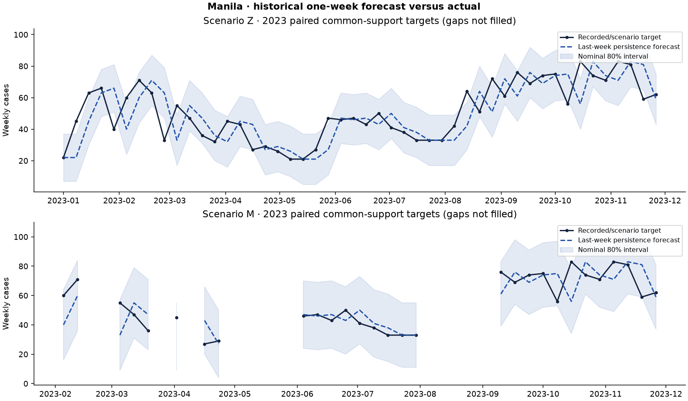
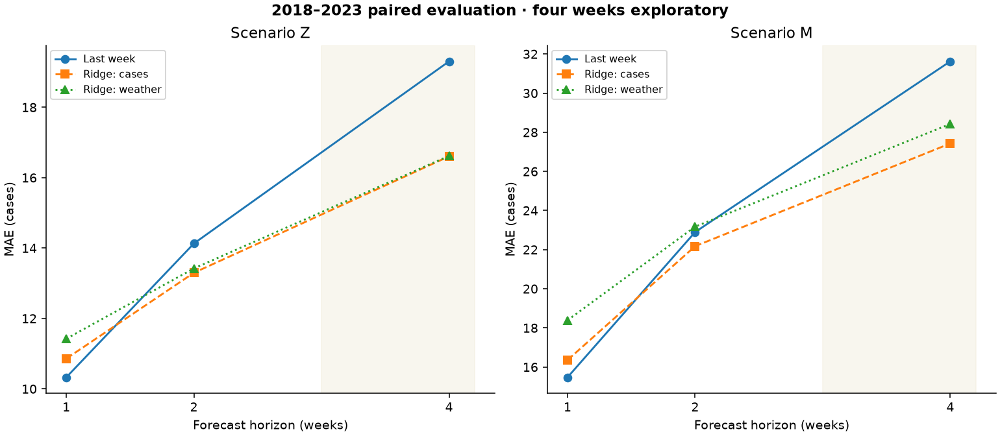

# Manila evaluation

Regenerate with `npm run evaluate`. Fixed seed 20261025. Every value below comes from saved per-origin evidence in data/processed/evaluation.json. No hosted writes.

## Protocol

Expanding rolling origins. Target-year folds. Fixed hyperparameters; 2017 development only; all methods on paired common support within each scenario/source experiment. COVID flag 2020-2021; no deletion of those years.

90th percentile of previous-year cases within ±2 ordinal calendar weeks of target; at least 5 observations, past data only. Research threshold, not a DOH outbreak declaration.

Paired moving blocks of 8 observed targets, circular sampling, 400 replicates, 95% percentile interval; gaps mean blocks are not always eight calendar weeks. Exploratory uncertainty, not a powered clinical comparison.

## Main test results (2018–2023, paired support)

|Scenario|Horizon|Model|N|MAE|RMSE|MASE|Skill vs naive %|95% skill CI|80% coverage|
|---|---:|---|---:|---:|---:|---:|---:|---|---:|
|Z|1|naive|308|10.328|16.173|0.939|0.000|0.000 to 0.000|0.812|
|Z|1|mean-4|308|13.415|20.461|1.215|-29.888|-45.908 to -16.147|0.818|
|Z|1|seasonal-naive|308|33.994|52.141|3.084|-229.142|-354.855 to -132.705|0.711|
|Z|1|endemic-channel|308|28.950|40.466|2.617|-180.305|-290.715 to -106.224|0.763|
|Z|1|ridge-cases|308|10.858|17.038|0.988|-5.136|-15.407 to 5.355|0.792|
|Z|1|ridge-weather|308|11.424|17.777|1.039|-10.608|-22.673 to 0.655|0.808|
|Z|1|ridge-no-rain|308|11.255|17.379|1.024|-8.974|-19.180 to 1.656|0.805|
|Z|1|ridge-no-temperature|308|11.438|17.779|1.040|-10.752|-23.719 to 1.039|0.818|
|Z|1|ridge-no-humidity|308|11.096|17.512|1.009|-7.435|-19.963 to 3.151|0.802|
|Z|1|tree-cases|308|19.831|34.009|1.784|-92.011|-136.880 to -50.247|0.812|
|Z|1|tree-weather|308|19.863|34.079|1.787|-92.320|-137.124 to -50.195|0.815|
|Z|2|naive|308|14.130|21.841|1.284|0.000|0.000 to 0.000|0.808|
|Z|2|mean-4|308|16.636|25.328|1.513|-17.739|-30.067 to -6.560|0.815|
|Z|2|seasonal-naive|308|33.994|52.141|3.087|-140.579|-242.002 to -69.587|0.708|
|Z|2|endemic-channel|308|28.959|40.474|2.620|-104.952|-186.646 to -49.744|0.760|
|Z|2|ridge-cases|308|13.298|21.247|1.215|5.889|-7.504 to 16.694|0.812|
|Z|2|ridge-weather|308|13.422|21.281|1.230|5.010|-9.374 to 18.521|0.786|
|Z|2|ridge-no-rain|308|13.419|20.930|1.229|5.032|-7.407 to 16.744|0.789|
|Z|2|ridge-no-temperature|308|13.406|21.531|1.228|5.125|-8.718 to 18.677|0.795|
|Z|2|ridge-no-humidity|308|13.105|20.944|1.201|7.250|-6.839 to 20.253|0.786|
|Z|2|tree-cases|308|21.334|34.955|1.927|-50.983|-84.550 to -23.134|0.805|
|Z|2|tree-weather|308|21.373|35.119|1.930|-51.264|-85.419 to -22.363|0.812|
|Z|4|naive|308|19.305|29.509|1.761|0.000|0.000 to 0.000|0.812|
|Z|4|mean-4|308|22.781|33.835|2.078|-18.004|-24.873 to -10.810|0.808|
|Z|4|seasonal-naive|308|33.994|52.141|3.090|-76.085|-151.826 to -25.514|0.708|
|Z|4|endemic-channel|308|28.982|40.494|2.626|-50.126|-102.969 to -10.422|0.760|
|Z|4|ridge-cases|308|16.606|26.454|1.531|13.979|0.715 to 26.717|0.805|
|Z|4|ridge-weather|308|16.621|26.662|1.531|13.906|-1.124 to 29.995|0.808|
|Z|4|ridge-no-rain|308|16.666|26.078|1.538|13.670|1.354 to 26.477|0.795|
|Z|4|ridge-no-temperature|308|16.806|27.480|1.547|12.945|-3.253 to 28.762|0.825|
|Z|4|ridge-no-humidity|308|16.287|26.377|1.502|15.633|-0.644 to 31.557|0.805|
|Z|4|tree-cases|308|23.524|36.270|2.142|-21.852|-46.214 to 1.004|0.818|
|Z|4|tree-weather|308|23.687|36.752|2.152|-22.697|-46.346 to 0.029|0.825|
|M|1|naive|116|15.474|22.419|1.271|0.000|0.000 to 0.000|0.750|
|M|1|mean-4|116|21.970|29.328|1.789|-41.978|-64.202 to -20.576|0.707|
|M|1|seasonal-naive|116|34.362|45.194|2.803|-122.061|-193.174 to -78.142|0.664|
|M|1|endemic-channel|116|28.793|38.387|2.342|-86.072|-144.759 to -46.676|0.681|
|M|1|ridge-cases|116|16.356|23.169|1.348|-5.699|-22.078 to 7.154|0.759|
|M|1|ridge-weather|116|18.390|25.361|1.510|-18.842|-40.849 to -4.659|0.784|
|M|1|ridge-no-rain|116|17.684|24.399|1.458|-14.279|-32.904 to -0.229|0.793|
|M|1|ridge-no-temperature|116|18.755|25.556|1.539|-21.205|-42.974 to -6.406|0.784|
|M|1|ridge-no-humidity|116|17.625|24.600|1.441|-13.899|-33.531 to -0.945|0.776|
|M|1|tree-cases|116|29.267|45.359|2.403|-89.135|-140.624 to -36.829|0.784|
|M|1|tree-weather|116|29.394|45.503|2.414|-89.955|-141.201 to -38.363|0.776|
|M|2|naive|117|22.897|31.333|1.871|0.000|0.000 to 0.000|0.692|
|M|2|mean-4|117|27.517|36.538|2.245|-20.175|-37.348 to -5.436|0.718|
|M|2|seasonal-naive|117|33.462|44.210|2.743|-46.137|-92.957 to -15.064|0.658|
|M|2|endemic-channel|117|28.774|38.377|2.351|-25.663|-60.092 to -0.568|0.684|
|M|2|ridge-cases|117|22.175|30.526|1.820|3.156|-15.189 to 17.224|0.718|
|M|2|ridge-weather|117|23.173|31.475|1.900|-1.204|-21.596 to 14.186|0.735|
|M|2|ridge-no-rain|117|22.713|30.662|1.868|0.803|-17.845 to 14.724|0.726|
|M|2|ridge-no-temperature|117|23.465|32.086|1.923|-2.477|-23.777 to 13.351|0.744|
|M|2|ridge-no-humidity|117|22.158|30.578|1.813|3.230|-16.594 to 19.261|0.701|
|M|2|tree-cases|117|32.257|46.714|2.664|-40.875|-75.657 to -10.792|0.761|
|M|2|tree-weather|117|32.611|47.259|2.689|-42.422|-77.471 to -10.735|0.744|
|M|4|naive|112|31.625|42.855|2.598|0.000|0.000 to 0.000|0.714|
|M|4|mean-4|112|37.013|48.893|3.035|-17.038|-25.906 to -7.533|0.714|
|M|4|seasonal-naive|112|33.429|43.971|2.758|-5.703|-41.900 to 14.892|0.661|
|M|4|endemic-channel|112|29.121|38.773|2.404|7.919|-16.879 to 25.677|0.679|
|M|4|ridge-cases|112|27.428|37.845|2.267|13.273|-3.623 to 29.411|0.705|
|M|4|ridge-weather|112|28.423|38.669|2.340|10.126|-9.183 to 24.913|0.688|
|M|4|ridge-no-rain|112|27.586|37.626|2.279|12.773|-4.894 to 26.707|0.670|
|M|4|ridge-no-temperature|112|29.494|40.463|2.422|6.737|-14.846 to 22.651|0.705|
|M|4|ridge-no-humidity|112|27.836|38.388|2.298|11.980|-6.951 to 28.180|0.714|
|M|4|tree-cases|112|35.512|48.999|2.970|-12.291|-42.763 to 13.351|0.786|
|M|4|tree-weather|112|36.626|50.018|3.057|-15.815|-43.137 to 10.708|0.768|

## Selection (2017 development only)

- Z: **ridge-cases**. Simplest within 5% of best mean 1/2-week MAE in 2017 development; weather excluded from operational selection because vintage availability is unverified. 2018-2023 held out.
- M: **ridge-cases**. Simplest within 5% of best mean 1/2-week MAE in 2017 development; weather excluded from operational selection because vintage availability is unverified. 2018-2023 held out.

## Weather conclusion

- Z, 1 week(s): ridge-cases MAE 10.858; ridge-weather 11.424; weather change -5.205% versus matched ridge-cases. This is retrospective evidence, not causation or operational availability.
- Z, 2 week(s): ridge-cases MAE 13.298; ridge-weather 13.422; weather change -0.934% versus matched ridge-cases. This is retrospective evidence, not causation or operational availability.
- M, 1 week(s): ridge-cases MAE 16.356; ridge-weather 18.390; weather change -12.435% versus matched ridge-cases. This is retrospective evidence, not causation or operational availability.
- M, 2 week(s): ridge-cases MAE 22.175; ridge-weather 23.173; weather change -4.502% versus matched ridge-cases. This is retrospective evidence, not causation or operational availability.

## Alert and interval evidence

|Scenario|Horizon|Model|N alerts|Precision|Recall|F1|ROC-AUC|Brier|False positive rate|Lead (correct-positive horizon)|
|---|---:|---|---:|---:|---:|---:|---:|---:|---:|---:|
|Z|1|naive|308|0.750|0.727|0.738|0.913|0.095|0.066|1.000|
|Z|1|endemic-channel|308|0.750|0.727|0.738|0.831|0.110|0.066|1.000|
|Z|1|ridge-weather|308|0.700|0.530|0.603|0.892|0.102|0.062|1.000|
|Z|2|naive|308|0.627|0.646|0.636|0.873|0.114|0.103|2.000|
|Z|2|endemic-channel|308|0.618|0.646|0.632|0.770|0.159|0.107|2.000|
|Z|2|ridge-weather|308|0.654|0.523|0.581|0.848|0.120|0.074|2.000|
|M|1|naive|116|0.775|0.738|0.756|0.904|0.128|0.122|1.000|
|M|1|endemic-channel|116|0.756|0.738|0.747|0.801|0.181|0.135|1.000|
|M|1|ridge-weather|116|0.710|0.524|0.603|0.864|0.151|0.122|1.000|
|M|2|naive|117|0.711|0.643|0.675|0.848|0.160|0.147|2.000|
|M|2|endemic-channel|117|0.682|0.714|0.698|0.764|0.222|0.187|2.000|
|M|2|ridge-weather|117|0.657|0.548|0.597|0.750|0.200|0.160|2.000|

## Year folds, ablations and source sensitivity

All 2018, 2019, 2020, 2021, 2022, 2023 and pooled COVID folds, all three leave-one-weather-driver-out ridge variants, both tree variants, and 2018–2020 DOH alternate-source sensitivities are saved in evaluation.json. Sparse or missing support is reported, not imputed. Different scenarios are not interchangeable cohorts.

## Limitations

- Daily zero/missing ambiguity unresolved
- DOH week-ending semantics unconfirmed
- Retrospective reanalysis is not real-time vintage data
- Sparse alert events can make AUC/precision undefined
- Probability of rise and alerts use empirical past residuals, not a separately validated clinical classifier
- Mean lead is correct-positive forecast horizon, not episode-based outbreak lead time
- Deaths anomalies flagged and excluded in DOH case training under existing policy
- No deep learning: fewer than 500 weekly observations per scenario
- No current 2026 surveillance; all forecasts historical

Training-only standardization, fixed L2=20, log1p target, no lognormal bias correction, >=32 training examples. Rain uses log1p(mm); temperature Celsius; humidity percent; lags 1-8 before origin; case lags 0-3 and annual harmonics + COVID indicator.

24 gradient-boosted stumps, learning rate .05, minimum leaf 16, 7 training-only quantile split candidates, L2 leaf=10, log1p target. Fixed, no tuning on test folds.

80% absolute-residual conformal radius with finite-sample rank; at least 20 matured out-of-sample targets by origin. No coverage guarantee under drift.

## Threshold-episode lead time and driver fits

A threshold episode begins only when a scored one-week target is above its past-only threshold and the immediately preceding calendar week is observed at/below threshold. Gaps do not establish episode onset. Lead is the earliest positive forecast targeting that onset among 1/2/4-week horizons. This measures research threshold episodes, not medically confirmed outbreaks. Eligible events, misses and exact origins are saved in evaluation.json.

|Horizon set|Scenario|Model|Eligible onsets|Detected|Mean lead weeks|
|---|---|---|---:|---:|---:|
|primary-1-2|Z|naive|18|7|2.000|
|primary-1-2|Z|mean-4|18|7|2.000|
|primary-1-2|Z|seasonal-naive|18|5|2.000|
|primary-1-2|Z|endemic-channel|18|7|2.000|
|primary-1-2|Z|ridge-cases|18|6|1.833|
|primary-1-2|Z|ridge-weather|18|6|2.000|
|primary-1-2|Z|tree-cases|18|5|2.000|
|primary-1-2|Z|tree-weather|18|5|2.000|
|primary-1-2|M|naive|9|3|2.000|
|primary-1-2|M|mean-4|9|3|2.000|
|primary-1-2|M|seasonal-naive|9|3|2.000|
|primary-1-2|M|endemic-channel|9|5|2.000|
|primary-1-2|M|ridge-cases|9|3|2.000|
|primary-1-2|M|ridge-weather|9|5|2.000|
|primary-1-2|M|tree-cases|9|3|1.667|
|primary-1-2|M|tree-weather|9|3|1.667|
|exploratory-1-2-4|Z|naive|18|9|3.778|
|exploratory-1-2-4|Z|mean-4|18|9|3.778|
|exploratory-1-2-4|Z|seasonal-naive|18|5|4.000|
|exploratory-1-2-4|Z|endemic-channel|18|9|3.778|
|exploratory-1-2-4|Z|ridge-cases|18|9|3.222|
|exploratory-1-2-4|Z|ridge-weather|18|8|3.000|
|exploratory-1-2-4|Z|tree-cases|18|5|4.000|
|exploratory-1-2-4|Z|tree-weather|18|5|4.000|
|exploratory-1-2-4|M|naive|9|4|3.000|
|exploratory-1-2-4|M|mean-4|9|3|4.000|
|exploratory-1-2-4|M|seasonal-naive|9|3|4.000|
|exploratory-1-2-4|M|endemic-channel|9|5|3.600|
|exploratory-1-2-4|M|ridge-cases|9|4|3.500|
|exploratory-1-2-4|M|ridge-weather|9|6|3.667|
|exploratory-1-2-4|M|tree-cases|9|3|3.000|
|exploratory-1-2-4|M|tree-weather|9|3|3.000|

Descriptive final one-week ridge coefficients and normalized boosted-stump split gains are saved by scenario/model with fit origin and feature names. These are training-fit summaries, not causal driver effects or out-of-sample feature attribution. Weather remains excluded from the public baseline.

## Alternate-source sensitivity (case-only)

These experiments replace 2018–2020 targets/training with DOH. Sample support changes; do not interpret between-experiment MAE differences as paired model skill. They do not test weather robustness under the alternate source.

|Scenario/source|Fold|Horizon|Model|N|MAE|
|---|---|---:|---|---:|---:|
|Z|2023|1|naive|48|10.042|
|Z|test-2018-2023|1|naive|308|10.328|
|Z|2023|1|ridge-cases|48|10.233|
|Z|test-2018-2023|1|ridge-cases|308|10.858|
|Z|2023|2|naive|48|12.604|
|Z|test-2018-2023|2|naive|308|14.130|
|Z|2023|2|ridge-cases|48|11.189|
|Z|test-2018-2023|2|ridge-cases|308|13.298|
|M|2023|1|naive|29|8.897|
|M|test-2018-2023|1|naive|116|15.474|
|M|2023|1|ridge-cases|29|9.548|
|M|test-2018-2023|1|ridge-cases|116|16.356|
|M|2023|2|naive|28|11.393|
|M|test-2018-2023|2|naive|117|22.897|
|M|2023|2|ridge-cases|28|11.151|
|M|test-2018-2023|2|ridge-cases|117|22.175|
|Z-DOH-sensitivity|2023|1|naive|48|10.042|
|Z-DOH-sensitivity|test-2018-2023|1|naive|288|10.531|
|Z-DOH-sensitivity|2023|1|ridge-cases|48|10.417|
|Z-DOH-sensitivity|test-2018-2023|1|ridge-cases|288|11.213|
|Z-DOH-sensitivity|2023|2|naive|48|12.604|
|Z-DOH-sensitivity|test-2018-2023|2|naive|288|14.424|
|Z-DOH-sensitivity|2023|2|ridge-cases|48|11.239|
|Z-DOH-sensitivity|test-2018-2023|2|ridge-cases|288|13.408|
|M-DOH-sensitivity|2023|1|naive|33|9.152|
|M-DOH-sensitivity|test-2018-2023|1|naive|209|11.847|
|M-DOH-sensitivity|2023|1|ridge-cases|33|9.702|
|M-DOH-sensitivity|test-2018-2023|1|ridge-cases|209|12.981|
|M-DOH-sensitivity|2023|2|naive|32|12.063|
|M-DOH-sensitivity|test-2018-2023|2|naive|208|16.721|
|M-DOH-sensitivity|2023|2|ridge-cases|32|10.960|
|M-DOH-sensitivity|test-2018-2023|2|ridge-cases|208|15.659|

## Figures

Recreate with npm run evaluate:plots (Python 3 with matplotlib). Missing targets break the plot line; no zero is inserted.
