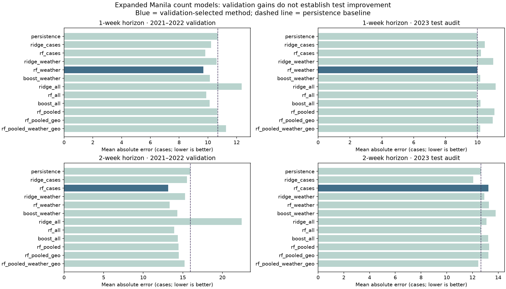

# Expanded Manila count models

Research checkpoint: 28 October 2026, Asia/Manila. Branch `feat/expanded-forecast`. Target: **Manila weekly case counts**, following the owner's request to consider all raw files and weather. This is separate from the historical NCR high-case classifier and the existing provisional ratio-reference panel.

## What changed

The new Python pipeline reads all five disease files, independently reconstructs complete Scenario M weeks, reconciles overlapping representations, joins past-only weather/context and compares twelve count methods at one- and two-week horizons. Recent 2026 data enters a separately labeled weighted experimental refit, as explicitly requested by the owner. It never enters historical validation/test or the older NCR classifier.

The app exposes the results at **`/expanded-model`**, linked from **Our Model**. It shows forecasts only while the full recent input snapshot agrees with the currently loaded Manila source and passes the existing 14-day gate. Historical evaluation remains available when recent predictions are hidden. No database migration or hosted write is part of this work.

The expanded candidates do **not** establish a reliable primary improvement over persistence. The public provisional reference therefore remains available; the new counts are explicitly experimental.

## Every raw file has an explicit role

| File | Read / use |
| --- | --- |
| Daily Manila workbook, 2018–2023 | Read original Sheet4 OOXML; 1,910 dated observations. Complete seven-row weeks supply primary post-2018 targets and past intraweek peak share. Missing dates stay missing. |
| DOH weekly CSV, 2016–2021 | NCR filtering; pre-2018 Manila weeks extend targets, preserving the audited suspect-row exclusions. NCR weeks reconcile monthly aggregates. |
| Manila MHD weekly CSV, 2018–2023 | All 308 rows checked against the workbook's sums, day counts and completeness flags. This is a derived representation; it cannot add 308 independent targets. |
| NCR monthly CSV with rates | All 1,037 rows reconcile case totals/week counts to the DOH weeks; incidence arithmetic is checked. Complete source-label months supply lagged Manila/rest-of-NCR count context in `all` variants. Population/rates are not treated as verified current denominators. |
| Manila weekly clean 2026 CSV | All 13 consecutive weeks validated; 12 checkable cumulative differences match. Experimental refit and separate prequential source check. Nine target values are estimated and are not counted as verified evaluation outcomes. |

The independent historical reconstruction must exactly match the existing 312 complete/reliable Scenario M counts or fitting fails. The long 2023–2026 gap is not filled. A pair requires its exact calendar origin and horizon target. Original files are never written.

All source SHA-256 values and roles are in `data/processed/expanded-manila/evaluation.json`. Unknown/new raw files fail the inventory check for explicit review rather than being silently ignored or pooled.

## Candidate inputs

**Case/season inputs:** log counts at calendar lags 0, 1, 2, 3, 4 and 7; available four-/eight-week means; number of available weeks; one-week log growth; target annual sine/cosine; target June–November indicator; origin estimate flag.

**Weather inputs:** ERA5 rainfall, temperature and humidity at delayed lags 1, 2, 4 and 8 weeks; four-/eight-week delayed rain sums; rain days; min/max temperature; delayed rain × humidity interaction. Each source weather week ends at least seven days before origin. No future observed weather or forecast weather that was unavailable at origin is used.

**Additional source context in `all` variants:** earlier complete-month Manila and rest-of-NCR totals; availability indicator; observed daily peak share in the origin week. A month is assumed available **45 days after month-end**, expires 45 days later and must have all expected Sunday source labels for all 17 units. This conservative timing assumption is not verified historical publication metadata. Missing late-period context stays missing rather than carrying 2020 values into 2026.

Missing feature values are retained as NaN until a **training-only median imputer** with missingness indicators handles them. A missing target is excluded, never imputed. Scaling is fitted inside each training partition.

Water shares within 200/500m, centroid river distance, elevation, low-elevation share and density are **constant within Manila**, so a standalone weekly single-city model cannot identify their separate effects. Three additional pooled-city comparisons test the spatial variation: `rf_pooled` excludes geography; `rf_pooled_geo` adds those six inputs; `rf_pooled_weather_geo` also adds weather. Other-city DOH targets through 2020 supply **3,756 / 3,878** extra available training pairs at one/two weeks, with death anomalies/missing deaths excluded. Each fit filters pooled targets to its own training cutoff; no future target or duplicate Manila outcome is added. All validation/test targets remain Manila only.

The pooled weather variant uses the shared Manila ERA5 point as an explicitly **regional proxy**, not falsely city-specific weather. Contemporary OSM/old elevation/population vintages are not historically harmonized, and density uses an unverified denominator. These are exploratory transfer models, not evidence of causal environmental effects or historically available operational geography. No outcome-derived city incidence is supplied as a predictor. There is no measured larval index, household standing-water inventory, verified flood time series, interventions, mobility, serotype or individual exposure data to add. These are missing-data needs, not invented covariates.

## Models and calibration

Twelve candidates: persistence; case/season ridge and Random Forest; weather ridge, Random Forest and histogram gradient boosting; three corresponding `all` context variants; and the three pooled-city controls described above. The pooled comparisons were added after the initial nine-method audit to test the requested water/elevation hypotheses. This expansion is recorded as exploratory, rather than presented as a preregistered search.

Every learned model predicts the **log change relative to the current count**:

```text
target correction = log(1 + future cases) − log(1 + origin cases)
count prediction = max(0, exp(log(1 + origin cases) + predicted correction) − 1)
```

This retains a direct persistence reference and avoids interpreting a classifier probability as a case count.

- Ridge: L2 penalty 20.
- RF regression: 160 trees, depth 5, minimum leaf 8, feature fraction 0.8, deterministic single-worker predictions.
- Histogram gradient boosting: 80 iterations, 7 maximum leaves, minimum leaf 15, L2 20, learning rate 0.04.
- Fixed seed: `20261028`. No parameters are retuned using the final test table.

Historical training is before 2021; validation is 2021–2022; final audit targets are in 2023. At a split boundary, training labels must already be known by the earliest validation/test origin. Candidate selection minimizes validation MAE, requiring at least **5%** validation improvement to depart from persistence. Final historical refits can use all historical targets after evaluation; they do not retroactively change the saved test forecasts.

| Horizon | Initial training pairs | Validation pairs | 2023 audit pairs | Final historical fit pairs |
| --- | ---: | ---: | ---: | ---: |
| 1 week | 180 | 55 | 42 | 277 |
| 2 weeks | 186 | 53 | 42 | 281 |

All candidates use the same outcomes within each horizon. One-/two-week pairs differ because missing calendar outcomes are excluded independently.

Four-observed-target circular paired block bootstrap, 1,000 draws, reports 95% skill intervals. Gaps mean a four-row block need not span exactly four calendar weeks. There is no multiple-comparison or clinical-validation claim. The historical years have been examined by earlier project research: this is an exploratory new protocol, **not a preregistered untouched prospective test**.

Nested yearly audits repeat selection using only earlier years, then evaluate the next year. All years 2018–2023 are listed; a fold with fewer than 32 training or 10 validation/test pairs is explicitly unavailable. They are not omitted based on performance.

## Actual results

| Horizon | Validation-selected method | Validation improvement vs persistence | 2023 model MAE | 2023 persistence MAE | 2023 skill | Paired 95% skill interval |
| --- | --- | ---: | ---: | ---: | ---: | --- |
| 1 week | `rf_weather` | 9.39% | 9.989 | 10.000 | 0.11% | −22.25% to 13.63% |
| 2 weeks | `rf_cases` | 17.67% | 13.241 | 12.667 | −4.54% | −41.89% to 15.36% |

Both uncertainty intervals cross zero. The two-week selected model is worse on this test. `rf_all` has test MAE 9.966 / 12.662, but it was not the validation winner; we do not switch to it after inspecting those values. The fixed-candidate full table and all nested-year outcomes remain in the generated artifact and UI.

| Pooled-city comparison | One-week validation MAE | One-week test MAE | Two-week validation MAE | Two-week test MAE |
| --- | ---: | ---: | ---: | ---: |
| Other-city training, no geography | 10.661 | 11.069 | 14.469 | 13.289 |
| Other-city training + geography | 10.677 | 10.966 | 14.485 | 13.237 |
| Other-city training + geography + regional weather | 11.262 | 10.167 | 15.241 | 12.454 |

None wins validation. The last variant's two-week test result is slightly better than persistence, but selecting it after viewing the test would be post-test cherry-picking. These results do not justify a riverside risk multiplier or a claim that geography improved the selected forecast.



Historical validation absolute residuals also generate nominal 80% diagnostic bands using finite-sample rank `ceil((n+1)*0.8)`. Fixed-band 2023 coverage is **66.67%** at one week and **88.10%** at two weeks. The artifact retains these diagnostic bands, but the app does **not** present them as calibrated intervals for the shifted 2026 source. They are not combined with or substituted for the existing provisional ratio ranges.

## Recent-source refit and examples

Recent source confidence is not known. Explicit assumed sample weights are **1 historical**, **0.5 unverified but not flagged estimated**, and **0.15 estimated**. These are not estimated confidence probabilities. Three final fits show sensitivity: historical only; historical + recent not-estimated targets; historical + all recent targets with estimate weights.

For the latest supplied 226 cases, week ending **25 October 2026**:

| Horizon / target week ending | Historical-only fit | Recent not-estimated refit | All-recent weighted refit shown experimentally | Persistence |
| --- | ---: | ---: | ---: | ---: |
| 1 week / 1 November | 200.05 | 199.00 | **201.34** | 226 |
| 2 weeks / 8 November | 180.59 | 184.10 | **184.79** | 226 |

The one-week selected model uses weather; the two-week selected model uses case history and season. Weather-inclusive alternatives were tested but did not win that validation comparison. All-factor variants are retained in the evaluation, not forced into the selected method to make a stronger claim.

There are 12 recent training pairs at one week (9 estimated targets), and 11 at two weeks (8 estimated targets). The first weekly value cannot form a pair without an earlier origin; all 13 rows still contribute to source audit and available feature history. Final fits use only targets already known at the latest origin.

Separate 2026 prequential predictions refit using only targets matured by each origin. Only **three non-estimated targets per horizon** can be checked, and all are still source-unverified. That is not sufficient for an accuracy claim. The app preserves the unofficial/experimental distinction and source matching.

## Weather provenance and biological interpretation

Existing 2015–2023 raw ERA5 caches and SHA-256 receipts are revalidated and aggregated to complete 168-hour Asia/Manila civil weeks. A new, separately cached 2026 request covers 1 January–20 October, enough for the latest delayed inputs:

- Provider: [Open-Meteo historical API](https://open-meteo.com/en/docs/historical-weather-api), ERA5 / Copernicus C3S / ECMWF; one Manila coordinate, 14.59932236 / 120.98493761.
- Request: hourly temperature, relative humidity and precipitation, timezone Asia/Manila, explicit ERA5 model. The exact URL, receipt and hash are included in the generated evidence.
- 2026 cache SHA-256: `35e90d43543a6a53c9606accf0505728694427452685d406b2880ca0cdcc2979`.
- Raw provider caches remain ignored; no private credentials or viewer coordinates are used. Final reanalysis is retrospective and may contain revisions unavailable at a historical origin.

[WHO](https://www.who.int/news-room/fact-sheets/detail/dengue-and-severe-dengue) identifies temperature, rainfall, humidity and urban conditions as relevant factors. Water-filled containers near homes are important habitats; a river-distance proxy is not an observed mosquito population. We test associations rather than assigning an invented riverside risk multiplier. Weather relevance does not guarantee incremental short-horizon prediction skill once recent cases are known.

The temporal approach follows the need for ordered validation and training-only preprocessing described in [scikit-learn cross-validation](https://scikit-learn.org/stable/modules/cross_validation.html) and [data-leakage guidance](https://scikit-learn.org/stable/common_pitfalls.html).

## Reproduce and view

Use the existing Python 3.12 ML environment with pinned `ml/requirements.txt`, plus Node 22.12+. The public UI needs only committed aggregate exports; research reproduction needs all five raw files and provider caches.

```powershell
npm run count:weather
npm run count:test
npm run count:evaluate
python scripts/plot-expanded-count.py
npm run count:check
npm run dev
```

Use the ML environment's Python for plotting if the system Python lacks matplotlib. `ML_PYTHON` overrides the runner's detected `.artifacts/ml-venv` environment. `ENV_OFFLINE=1` prevents provider retrieval when reproducing from caches. Evaluation itself reads caches only and performs no network or database operations.

Open **Our Model → Review expanded count models**, or `/expanded-model`. Source expiry is expected from 9 November unless a reviewed new week is supplied and the expanded experiment is regenerated. Hosted publication does not automatically train this experimental model. If the hosted source changes, the exact source-snapshot check hides old experimental counts.

`count:check` is a prebuild guard: it checks public/processed artifact parity, available raw fingerprints, tracked context fingerprints, exact recent-source agreement, validation-based selection and saved test calculations. Selected weather models require complete delayed weather inputs before publication. It does not require ignored raw files on teammates' machines. It does not claim fresh model training at every build. Runtime versions and exact parameters are saved in the artifact. A repeated full fit/evaluation checks deterministic numerical reproduction separately from the build guard. [Verification and diagnostic record](evidence/expanded-manila-checks.md).

## What this does not establish

No guaranteed improvement, current official outbreak risk, causal environmental effect, barangay prediction, verified 2026 accuracy, calibrated 2026 interval or successful hosted deployment is claimed. The old NCR RF, historical evaluation and provisional ratio reference remain intact. Original source verification, credential rotation, hosted setup, DPO approval and human review gates still apply; collection remains closed. Test locally and self-review before merging; main deploys automatically and the user pushes.
