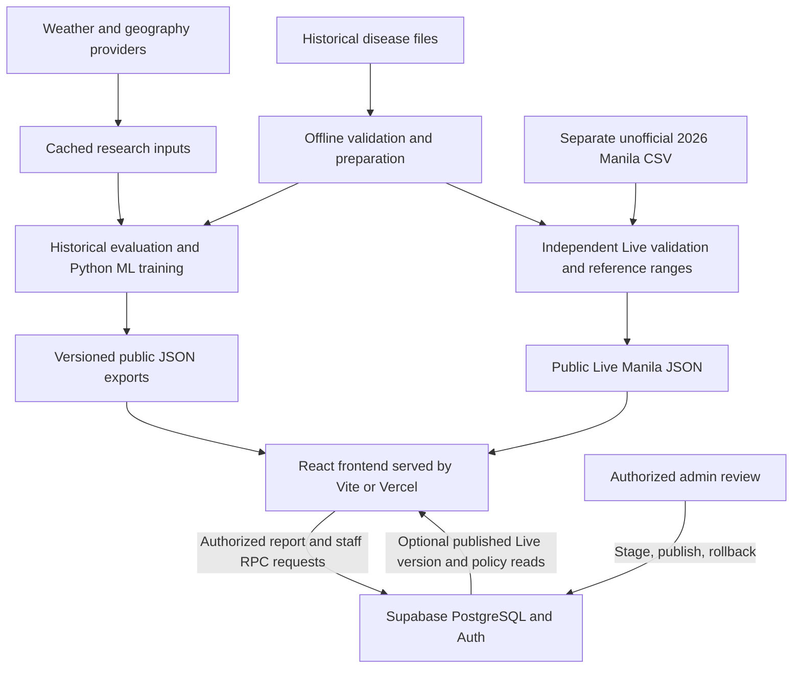

# DengueWatch: full system guide for the group

Reviewed against the current `feat/live-manila` code on **28 October 2026 (Asia/Manila)**. This guide describes the implementation, rather than treating older project proposals as completed features. Numerical examples below belong to the saved datasets and evaluation; they will not automatically describe a later release.

**Expanded-model addendum:** `feat/expanded-forecast` adds `/expanded-model`, linked from Our Model. It tests all raw-source roles, delayed weather and season in a separate Manila count experiment, including an explicitly weighted 2026 refit. It does not replace the NCR classifier or provisional baseline because reliable improvement was not established. Read [Expanded Manila count models](EXPANDED_MANILA_MODEL.md) for the actual results, formulas and update commands. Statements below about the unchanged historical training and provisional ratio method refer to those original pipelines, not this new experiment.

## 1. What we built

DengueWatch is a web-based dengue research and awareness system. It brings together historical case records, maps, retrospective model comparisons, a separate provisional Manila estimate, prevention information, and a controlled community-reporting workflow.

The central distinction everyone in the group must understand is:

| Part of the system | What it produces | Method |
| --- | --- | --- |
| Historical NCR research / Replay | Probability of a next-week high-case event for an NCR reporting unit | Random Forest classifier selected using training validation |
| Historical Manila count forecast | A dated future-week count relative to the historical record | Persistence: repeat the latest recorded weekly count |
| Live Manila provisional panel | Recent unofficial weekly counts and one-/two-week reference ranges | Persistence reference plus historical case-change ratio quantiles |
| Community reporting | Private, unverified reports; privacy-filtered aggregates if enabled | Validation, moderation and aggregation; no predictive model |

These outputs answer different questions. A probability of a high-case event is not a predicted number of cases. A community report is not an official case. A recent-looking chart does not establish current official risk.

## 2. How the whole system connects



Weather is used by research experiments and dated context. The arrow into research does **not** mean the shipped Random Forest or provisional Manila ranges use weather.

There are three layers:

1. **Frontend:** the browser displays pages, charts, maps and controls.
2. **Preparation/research layer:** local or scheduled scripts validate source files, evaluate methods and export reproducible results.
3. **Database backend:** Supabase provides PostgreSQL, authentication, permissions and controlled stored functions for reporting and reviewed publications.

The public research demo can work without a database connection because its main historical and provisional outputs are shipped as JSON. The repository does not require an always-running Express, Flask or Django prediction server. Training does not happen every time someone opens a page.

## 3. Frontend: what the visitor sees

The frontend uses **React 19**, **TypeScript**, **Vite**, and **React Router**. CSS and reusable components control the design. Recharts is available for research charts; some current charts and lightweight boundary previews use SVG directly. MapLibre handles the interactive street map.

| Route | Purpose | Main implementation |
| --- | --- | --- |
| `/` | Manila-first Dashboard: history, Live/Replay, other NCR areas, model link and care information | `src/redesign/Dashboard.tsx` |
| `/risk-map` | Interactive NCR map, week selection, city details and accessible alternatives | `src/redesign/RiskMap.tsx` |
| `/our-model` | Select a historical area/week; compare the saved prediction with what happened | `src/redesign/OurModel.tsx` |
| `/report` | Community report steps, collection status, privacy and withdrawal | `src/pages/ReportV2.tsx` |
| `/about` | Project explanation, methods, sources and credits | `src/redesign/About.tsx` |
| `/admin/*` | Restricted sign-in, MFA, moderation and dataset publication | `src/pages/Admin.tsx` |

Older addresses such as `/methodology`, `/data-sources`, `/privacy` and `/trends` redirect into the current pages/drawers. Old documents listing different primary pages describe earlier milestones.

The current identity is DengueWatch's own drop/wave design, with Figtree/Fraunces typography and day, night and automatic appearance. English/Filipino labels are paired in the interface. Machine-assisted Filipino wording still needs native review.

Large pages and the map engine load lazily, reducing initial work. Shared data hooks handle loading, failure and explicit retry. An error boundary displays a recovery message if a page fails. The report flow never resubmits automatically after an uncertain network result.

On the Dashboard, one forecast state is passed into both the Manila section and the other-NCR section. Their Live/Replay controls therefore agree. Replay shows dated historical research; Live shows only the separate Manila source. The other 16 NCR units have no recent data in that mode.

### What happens when a page opens

1. The browser receives the HTML/CSS/JavaScript application shell.
2. React Router selects the page from the URL.
3. That page requests the relevant same-origin public JSON resources.
4. Hooks store the response and expose loading, data and error states.
5. Components format dates, counts, gaps and source limitations.
6. When configured and online, certain features also ask Supabase for collection policy or an authorized published dataset.
7. Changing a historical city/week usually selects another saved row; it does not retrain a model.

## 4. Disease data: sources and preparation

### Historical Manila

The daily workbook covers **1 January 2018–2 December 2023**, with **1,910 supplied daily observations** and **252 absent dates within coverage**. Absence is unresolved: a missing date might mean no report rather than zero cases.

The preparation pipeline therefore preserves two interpretations:

| Scenario | Missing daily dates within supplied coverage | Use |
| --- | --- | --- |
| **M** | Treat as missing; exclude incomplete daily-derived weeks from supervised targets/scoring | Default public historical view and Live reference |
| **Z** | Assume zero within coverage; retain the assumption as a flag | Sensitivity analysis |

Neither scenario invents values outside source coverage. The final boundary week ending **3 December 2023** contains only six supplied calendar days, with 30 recorded cases; it is retained as partial and excluded from scoring in both scenarios.

For a complete daily-derived week:

```text
weekly cases = sum of the seven daily case counts
```

The stitched historical series uses DOH weekly labels before 2018 and daily-derived Manila weeks afterward. Overlapping sources are compared, never added together. The full processed timeline has 413 Sunday labels per scenario; a timeline entry is not automatically a usable observation.

The public record and the latest complete usable forecast origin can have different dates. The interface must show the saved origin/target rather than implying a prediction for the current calendar week.

### Historical NCR

The DOH EPI CSV contains national weekly location records; exact NCR filtering yields **17 reporting units: 16 cities and Pateros municipality**. The supplied broader NCR source runs through January 2021, but the classifier experiment uses the full-year cutoff **10 January 2016–27 December 2020**.

Three calendar weeks are absent: **13 November 2016, 6 January 2019 and 15 November 2020**. They remain missing. A lag must mean the actual preceding calendar week, not the preceding available row.

Other quality rules include explicit dates, nonnegative whole counts, known location names, duplicate detection, coverage flags, source fingerprints and disclosure of deaths/count inconsistencies. Deaths are not predictors. Quality exclusions differ by experiment, so sample counts must be read from that experiment's saved results.

Monthly files are roll-ups of weekly data, not another independent source. Fixed population denominators carry provenance limitations; we do not present unverified rates as current incidence.

### Recent Manila, 2026

This is a **separate, unofficial team transcription** reportedly taken from Manila Information Office Facebook posts. The supplied CSV contains **13 consecutive weeks, 27 July–25 October 2026**. Four weekly values are not flagged estimated; nine are estimated. “Observed” in this feature means not flagged estimated, not independently source-verified.

All 12 checkable consecutive cumulative differences agree with the weekly values. The first weekly value, 54, cannot be checked without its preceding total. Original post links/screenshots, three interpolation explanations, source definitions and republication permission remain unresolved.

The 2023–2026 gap is left empty. These 13 rows do not enter historical training, evaluation, thresholds or Replay. They cannot support a defensible new Random Forest training experiment by themselves.

## 5. Random Forest: the historical NCR classification model

### The question it answers

For each reporting unit and forecast origin week `t`, estimate whether next week's count will exceed a research cutoff computed using only information available through `t`.

```text
cutoff(city, t) = max(mean of observed counts through t
                     + sample standard deviation through t, 10)

actual target = 1 if cases at t+1 > cutoff(city, t), otherwise 0
```

The standard deviation uses `n−1` in the denominator. The main definition uses SD multiplier 1 and minimum 10; all nine combinations of multiplier `{0.5, 1, 1.5}` and minimum `{5, 10, 20}` are reported as sensitivity analyses. The first 26 calendar weeks are burn-in.

For example, if the historical mean is 20 and sample SD is 8, the cutoff is 28. An actual next-week count of 29 is positive; 28 is negative. This is a study definition, not an official outbreak declaration.

### Inputs: 28 features

The model receives 11 numeric history/context features plus 17 one-hot location indicators:

- Current count and the preceding three calendar-week counts: 4 features.
- Four-week and eight-week means: 2 features.
- Current count divided by `max(four-week mean, 1)`: 1 feature.
- Current count divided by the current research cutoff: 1 feature.
- Origin ISO week number: 1 feature.
- Other-NCR current total and four-week mean, excluding the selected city: 2 features.
- One binary indicator for each of the 17 reporting units: 17 features.

An input window or target with a required calendar gap is excluded. Future case counts, participant reports and future weather are not inputs. Weather is not part of this NCR classifier.

### How the algorithm works

A decision tree learns a sequence of feature comparisons leading to leaf probabilities. A Random Forest fits many trees on sampled training data with randomized feature choices, then averages their probabilities. Combining trees generally reduces dependence on any single tree; performance still has to be measured on held-out data.

The current exported RF configuration is:

| Setting | Value |
| --- | --- |
| Trees | 100 |
| Maximum depth | 8 |
| Minimum samples in a leaf | 15 |
| Class weighting | `balanced_subsample` |
| Fixed experiment seed | `20261026` |
| Model version | `d783ae4e1a32081b` |

Python/scikit-learn performs fitting and evaluation. Browser-compatible JSON exports contain tree branches, thresholds, leaf probabilities, feature order, calibration parameters, source hash and model version. Private training objects remain local; the browser does not load executable pickle/joblib objects.

### Training, validation and test separation

The headline split is chronological **70:30 by eligible distinct target weeks**, shared across all areas:

| Partition | Target dates | Weeks | City-week rows |
| --- | --- | ---: | ---: |
| Training | 17 July 2016–25 August 2019 | 145 | 2,465 |
| Held-out test | 1 September 2019–8 November 2020 | 63 | 1,071 |

Not every source week is eligible because of burn-in and missing windows. Three expanding-window folds inside training select parameters by mean balanced accuracy. Candidate DT depths are 3–8 with leaf sizes 5/15; RF candidates use 100/200/300 trees, depths 4/8 and leaf sizes 5/15. Test results do not choose parameters.

The study compares RF, Decision Tree, majority, persistence and seasonal-history methods. The shipped RF was selected by training-validation performance among these methods. A separate row-random 70:30 comparison is reported, but mixing correlated cities/dates makes that comparison less representative of forecasting.

### Calibration, decisions and display bands

Out-of-fold training probabilities fit a sigmoid/Platt calibrator. For the current RF:

```text
r = average tree probability
p = 1 / (1 + exp(−(8.108812230059316 × r − 4.970157728869576)))
predicted class = 1 when p >= 0.26
```

The 0.26 operating point was selected on validation balanced accuracy. It is not a universal medical threshold.

Four display bands use validation-probability percentiles: approximately **0.12878, 0.55357 and 0.84765**. Equality enters the higher band. These relative display bands are distinct from both the count cutoff defining the target and the 0.26 binary decision point.

The TypeScript scorer follows exported tree branches with float32 input comparisons to match scikit-learn. A parity fixture checks 600 actual rows across all five methods, including exact classes and probability error at most `1e−9`. Current Replay normally reads saved predictions rather than scoring on every interaction.

### What the saved evaluation actually shows

The held-out cohort contains 1,071 city-week rows, including 225 positives:

| Method | Accuracy | Balanced accuracy | Precision | Recall | F1 |
| --- | ---: | ---: | ---: | ---: | ---: |
| Random Forest | 90.94% | 92.47% | 71.33% | 95.11% | 81.52% |
| Persistence rule | 95.05% | 93.61% | 86.13% | 91.11% | 88.55% |
| Decision Tree | 61.44% | 72.82% | 34.44% | 92.44% | 50.18% |

Persistence has higher held-out F1 here. RF remains the validation-selected model; we do not replace the selection based on the test outcome or claim it beats every baseline. RF-minus-persistence paired F1 confidence interval is approximately **−0.154 to −0.016**.

Early onset is harder than recognizing continuing elevated weeks. Among 833 rows below the cutoff at origin, only 20 next-week positives exist. RF onset recall is 50%, precision 15.62%, F1 23.81%, with wide uncertainty. Persistence cannot alert in that subset by construction. This is limited exploratory early-warning evidence.

Evaluation also includes ROC-AUC, average precision, Brier score, calibration plots, confusion matrices, per-city results, yearly earlier-year tests and threshold sensitivities. Week-block bootstrap intervals retain temporal grouping; they are not clinical validation.

## 6. Historical Manila: count forecasting and calculations

The public historical count baseline is **persistence**:

```text
predicted cases at t+h = recorded cases at t
```

If the last usable complete week has 40 cases, persistence predicts 40 for each requested horizon. Its simplicity gives a strong, auditable baseline against which more complicated methods must prove improvement.

Research compares the four-week mean, seasonal naive, endemic-channel baseline, log-count ridge regression, tree models, weather variants and ablations. Main historical horizons are one, two and four weeks; four-week findings remain exploratory. Ridge fits `log(1 + cases)` with regularization; the environmental addendum separately uses AR(2) log-count ridge with fixed L2 penalty 20. Those experiments are not the NCR RF classifier.

Historical count uncertainty uses earlier out-of-sample residuals whose targets are already known at the origin:

```text
residual = actual − predicted
radius = conservative finite-sample 80% absolute-residual order statistic
lower = max(0, predicted − radius)
upper = predicted + radius
```

At least 20 mature residuals are required; otherwise ranges/probabilities are unavailable. The absolute-error rank is `ceil((n+1) × 0.8)`, capped at the largest available residual. Time dependence and distribution changes can cause actual coverage below 80%.

An empirical probability of exceeding count `c` is `(1 + number of residual-adjusted forecasts > c) / (n + 2)`. Historical count-alert cutoffs use the 90th percentile of earlier-year counts near the target calendar week, with a minimum support requirement. This threshold differs from the NCR mean-plus-SD label.

Rolling-origin evaluation repeatedly trains using the past and tests on a later target. Comparisons use matched valid targets within the stated experiment. Scenario M and Z, environmental experiments and source sensitivities can have different support; do not compare their MAEs as if they used identical rows.

Useful metric definitions:

`TP` means correctly predicted positive; `TN` correctly predicted negative; `FP` a false alert; `FN` a missed positive. A “positive” here means the study's high-case event, not a patient's laboratory result.

| Metric | Calculation / meaning |
| --- | --- |
| MAE | Average `abs(actual − predicted)`, measured in cases |
| RMSE | Square root of average squared error; penalizes large misses more |
| Skill versus persistence | `100 × (1 − model MAE / persistence MAE)`; positive is better |
| Precision | `TP / (TP + FP)`; fraction of issued positive predictions that were correct |
| Recall | `TP / (TP + FN)`; fraction of actual positives detected |
| F1 | `2 × precision × recall / (precision + recall)` |
| Accuracy | `(TP + TN) / all assessed outcomes` |
| Balanced accuracy | Average of sensitivity and specificity |
| Brier score | Mean squared probability error; lower is better |
| Range coverage | Assessed actual outcomes inside the range divided by assessed outcomes |
| False-positive rate | `FP / (FP + TN)`; different from the fraction of issued alerts that are false |

## 7. Live Manila: exact provisional logic

### Deriving weekly cases

The supplied posts reportedly describe cumulative cases since 1 January. For consecutive totals:

```text
new weekly cases = this cumulative total − previous cumulative total
```

A difference touching an estimated cumulative total remains estimated. A multiweek change cannot be called a single observed week. New append rows require a consecutive Monday–Sunday interval, the following report Monday, an allowed public Facebook HTTPS post URL, explicit flags and an explanatory note when estimated. Decreasing totals, duplicates, invalid dates, unknown fields and inconsistent differences are rejected. Corrections or a new-year cumulative reset require separate review.

### Historical reference ranges

Use **312 reliable, complete Scenario M historical weeks**. Choose origin weeks with at least 100 cases; pair each with the exact calendar week one or two weeks ahead. There are **40 valid one-week pairs** and **42 two-week pairs**.

```text
historical ratio at horizon h = cases(t+h) / cases(t)
lower = floor(latest count × ratio p10)
middle = round(latest count × ratio p50)
upper = ceil(latest count × ratio p90)
```

Quantiles use linear type-7 interpolation: sort values and interpolate at rank `(n−1) × q`. Missing outcomes are excluded, never shifted to the next available row.

Using the supplied latest **226 cases, week ending 25 October 2026**:

| Horizon | Ratio p10 / p50 / p90 | Range | Ratio middle | Persistence reference | Target |
| --- | --- | --- | ---: | ---: | --- |
| 1 week | 0.717923 / 0.956780 / 1.210372 | 162–274 | 216 | 226 | 26 October–1 November |
| 2 weeks | 0.665183 / 0.899780 / 1.346874 | 150–305 | 203 | 226 | 2–8 November |

The ratio middle and persistence reference are different quantities. We do not describe 216 or 203 as Random Forest outputs.

These are empirical historical 10th–90th ratio ranges. Leave-one-year-out coverage is **29/40 = 72.50%** and **32/42 = 76.19%**. Each fold removes training pairs whose origin or target enters the held-out year. These results do not justify calling the ranges calibrated 80% prediction intervals for 2026.

Thresholds 80 and 150 are also reported as sensitivity checks. Threshold 150 has only 12 pairs per horizon and especially poor coverage. The primary threshold remains 100; it was not selected to hide the sensitivity results.

### Direction and historical context

Take the last three weekly values not flagged estimated. If their first and last values are `a` and `b`, separated by `w` actual calendar weeks:

```text
average weekly rate = (b / a)^(1 / w) − 1
```

The steady band is the historical median absolute relative weekly change, approximately **17.8535%**. Above it means Rising; below its negative means Falling; inside means Steady. Insufficient values or an undefined zero-base rate produce Unavailable.

For `267 → 226 → 226`, the rate is about **−7.9977%**, so the label is **Steady**. That label is descriptive, not a statistically significant trend test.

The context percentile is the strict fraction of complete historical counts below the latest value: **99.6795%**, displayed as 99.7%. Historical maximum is 257. Latest 226 is below that maximum; the supplied recent peak 267 is above it **if confirmed**. Different source definitions prevent a verified year-to-year comparison. None of these comparisons declares an outbreak.

### Freshness and publication

Live eligibility uses Asia/Manila calendar dates. Source age **0–14 days inclusive** is eligible; future dates are not. The supplied seed becomes stale on **9 November 2026** unless updated. The hook rechecks every minute. Stale data returns the public mode to Replay.

The browser loads `/live-manila/weekly.json`, then optionally asks `published_manila_live_input` for an authorized hosted publication. If that service is unavailable, the shipped version remains available subject to freshness. The read uses an eight-second bound and avoids overlapping requests. Offline mode skips the hosted lookup.

Historical quantiles, coverage and direction tolerance are generated offline and frozen in the private SQL seed. The publication RPC projects validated rows using those frozen values; the browser does not fit quantiles. A SQL parity check compares publication output with the script output.

Live has no RF probabilities, classes or retrospective outcomes for any of the 17 areas. Manila gets a separate provisional indicator; the other 16 stay neutral with No recent data. The older complete-NCR upload/scoring utilities have a distinct 21-day gate; they are **not** what the current public Live selector invokes.

## 8. Weather, geography and external services

| Source / service | Role | Important distinction |
| --- | --- | --- |
| Open-Meteo historical API | ERA5 rainfall, temperature and humidity; historical research and dated Manila context | Gridded reanalysis, not direct PAGASA station readings |
| Copernicus C3S / ECMWF ERA5 | Underlying primary weather dataset | Manila research uses one coordinate, not independent readings for every city |
| NASA POWER | Independent weather cross-check, including MERRA-2-based variables | Not blended into the shipped prediction inputs |
| Open-Meteo forecast API | Separate cached map/outlook weather context | Weather forecasts are not dengue forecasts |
| HDX / NAMRIA / PSA / OCHA boundary resources | Geographic shapes and source crosswalks | Name matching does not prove surveillance catchment equivalence |
| PSA-labelled population data | Geographic/descriptive research | Denominator provenance and vintage limitations remain |
| OpenStreetMap / Protomaps PMTiles | Local street/coastline basemap | Public geography, not disease observations |
| OpenFreeMap | External basemap fallback | Provider sees normal network metadata; no report records are sent |
| OpenTopoData SRTM90m and OSM water inputs via Overpass | Environmental/geographic research proxies | No causal or validated barangay-risk claim |
| Supabase | PostgreSQL, Auth, PostgREST/RPC | Needed for staff operations and report collection, not basic JSON demo |
| Vercel | Frontend hosting and route/security headers | A frontend deployment does not apply database migrations |
| GitHub Actions | Defined quality, weather, retention and scan workflows | A scheduled YAML file does not prove successful hosted execution |

For Manila, the historical weather script requests hourly `temperature_2m`, `relative_humidity_2m` and `precipitation` at **14.59932236, 120.98493761**, timezone **Asia/Manila**, model **ERA5**, for 2015–2023. Weekly rainfall is summed; temperature/humidity are averaged. Environmental checks require complete weeks and use delayed, past-only features.

The environmental addendum freezes lag choices from 2016–2017 training: rain lag 3, temperature lag 1, humidity lag 3, and an eight-week rainfall window. It compares case autoregression, season, weather, combined and ablated inputs. It does not establish a reliable primary one-/two-week improvement over persistence, so environmental methods were not promoted.

Weather provider requests happen in scripts, with cached raw responses, retrieval timestamps and SHA-256 receipts. The recent Manila refresh uses delayed completed weather context and limits attempts to once per 24 hours on its filesystem. A defined GitHub workflow runs at 21:31 UTC, **05:31 Manila the following day**, to refresh and validate public weather caches. We have not established its current hosted success merely by reading that definition.

The browser reads exported weather JSON; it does not ask visitors for GPS or call a weather API for their location. Provider failure leaves the baseline forecast usable. Weather is context, not an input to the current NCR RF or Live Manila range calculation.

Exact request URLs and provider-specific attribution are in `data/external/SOURCES.md`; NASA details are in `data/external/POWER.md`. Credentials are unnecessary for the public weather downloads used here.

## 9. Maps: rendering and meaning

The current map uses **MapLibre GL JS**, a real local Metro Manila **PMTiles** extract and local glyph/sprite assets. Local street tiles load first with a 15-second loading budget. OpenFreeMap is attempted if local basemap loading fails. Labelled polygons remain available if the basemap fails; an SVG alternative handles WebGL failure.

City boundaries come from `public/geo/ncr-cities.geojson`, with explicit name matching in the NCR crosswalk. There are 17 modeled reporting units. A street visible beyond those polygons does not imply modeled coverage there.

In Replay, calibrated research probability controls city color; missing probabilities are neutral. The map uses the same selected area/week as its accompanying details and table. Keyboard city controls, focus handling, high contrast, labels, hatching and reduced motion provide alternatives to color and animation.

In Live, the map displays the separate provisional Manila indicator. It does not turn the 226 count into an RF probability or fabricate current values for other cities. City counts are never divided among barangays to create disease hotspots.

Earlier Tondo population/crowding views and national seasonal-outlook experiments remain in repository history/resources. They are not the current public NCR prediction method. Population density, water proximity and historical burden must not be described as measured individual infection risk.

## 10. Backend: database, permissions and staff work

Supabase exposes PostgreSQL through its client SDK/PostgREST. A **table** stores records; an **RPC** calls a database function that validates the request and performs a controlled operation. A migration is a versioned SQL change. The browser calls approved RPCs rather than freely writing sensitive tables.

| Database object/group | Purpose |
| --- | --- |
| `historical_surveillance`, older forecast/cache objects | Earlier stored historical ingestion and cache paths; current public research is mainly shipped JSON |
| `reporting_v2_policy` | Backend-controlled collection gate and consent version |
| `community_signals` | Restricted individual community reports |
| `reporting_area_catalog`, `manila_barangay_catalog` | Allowed coarse reporting geography |
| `private.staff_roles` | Appointed moderator/admin roles |
| `staff_audit` | Restricted record of staff actions and record IDs |
| `surveillance_uploads` | Earlier staged surveillance upload workflow |
| `ncr_model_uploads` | Reviewed, versioned complete-NCR model input batches |
| `manila_live_uploads` | Separate versioned aggregate Manila publications |
| `private.manila_live_seed` | Immutable Live baseline, frozen method payload and historical reference counts |
| Private challenges/rate buckets | Anti-spam state; not publicly readable |

**Row Level Security (RLS)** restricts access even if someone bypasses the visible UI. Server functions check permissions, fields and state. Hiding an admin button is not the authorization mechanism.

Staff sign in through Supabase email/password and complete TOTP MFA. Protected operations require an appointed role and **AAL2**, the second authentication assurance level. Moderators review reports; admins also manage dataset publication and audit views. Public visitors do not need accounts for the research pages.

Uploads follow preview → stage → review → publish, with status/audit records and rollback. Complete NCR batches need known names, all 17 units, consecutive Sunday weeks and sufficient history; an upload never silently retrains the forest. Current public Live remains the separate Manila path.

Manila publication is append-only relative to its reviewed parent. Parent checks and locking prevent competing publications from silently overwriting each other. The current publication can be rolled back to its predecessor or shipped baseline. Private evidence paths and staff actor IDs are excluded from the public projection.

The new Live migration is `supabase/migrations/20261028000100_live_manila.sql`. It has local SQL tests; hosted application, real MFA, publication and rollback still require owner setup/verification. `npm run dev` does not install it.

## 11. Community reports: complete flow and privacy calculations

**New collection remains closed.** The implemented workflow can be previewed; we have not opened a real participant collection program.

If authorized and enabled later:

1. The page reads `reporting_v2_policy`. Missing configuration, offline state, read failure or an unexpected consent version keeps it closed.
2. The visitor chooses household concern or area cluster, a permitted coarse area, an onset date within the last 90 days, optional symptoms, affected-person range and optional short note.
3. Barangay selection is available only for the reviewed Manila catalogue. No GPS, exact address or requested name is collected.
4. The visitor reviews the data and explicitly consents to `community-v2`.
5. The browser requests `report_challenge`, then solves a SHA-256 proof of work: `challenge_id:salt:nonce` must hash to two leading zero bytes, equivalent to four leading hexadecimal zeroes. Difficulty is 16 bits; the client bounds its search.
6. `submit_signal_v3` validates the fields and delegates to authoritative server safeguards. The server checks the collection gate, consent, dates, challenge age/use, honeypot and limits.
7. Duplicate/burst heuristics can quarantine the report. Staff moderation is content review, not medical confirmation.
8. A successful server response returns a private `DW2-...` withdrawal code and a receipt of stored fields. Only a hash of the code is stored server-side. The UI shows the original once and does not put it in URLs or persistent browser storage.
9. Public aggregation includes only approved, nonwithdrawn, nonexpired reports at least **72 hours old**, with at least **3 reports per area/onset-week group**.

The public aggregate is a **count of reports**, not a confirmed case count or the sum of approximate affected-person ranges. An absent group can mean no eligible reports or privacy suppression; it is not a confirmed zero.

Current safeguards include a maximum of five submissions per 15-minute salted client-IP-derived bucket when a proxy IP is available, a global 200-challenges-per-minute ceiling, a global 30-submissions-per-minute ceiling, five-minute single-use challenge validity, duplicate checks and burst quarantine. The original report path quarantines a burst after three recent same-barangay records within five minutes; the scoped extension also checks its area/type/onset/symptom fingerprint over 24 hours. Raw IP is used transiently for hashing and is not stored by the application. The bucket changes with each time window; this does not make the system perfectly anonymous or resistant to all abuse. Rate-bucket physical cleanup depends on successful requests or hourly retention, with a documented maximum of about 75 minutes under that schedule.

Notes are limited to 250 characters and scrubbed for common email/phone/address/name patterns in both frontend/backend paths. These filters are imperfect. Users are asked not to provide identifying details, and private staff review remains necessary.

`withdraw_signal` immediately excludes the report and clears identifying/coarse optional details according to SQL policy. Invalid and already-withdrawn codes return indistinguishable outcomes. Rows expire after **90 days**; public queries enforce expiry even if physical cleanup is delayed. A private purge function and retention workflow support deletion. Hosted schedules, success logs and provider backup/log retention still need verification; application deletion does not prove backup erasure.

Community reports never become RF training data, official surveillance counts, count-forecast inputs or medical diagnoses.

## 12. The APIs and files the app reads

The `/api/v2/*.json` addresses below are **static versioned exports**, not live database endpoints:

| Path | Contents/use |
| --- | --- |
| `/api/v2/manila.json` | Manila M/Z history, dated snapshots, forecasts, summaries and flags |
| `/api/v2/ncr.json` | Historical NCR records, geographic/source context and descriptive denominators |
| `/api/v2/backtest.json` | Saved count predictions versus actual outcomes |
| `/api/v2/environment.json` | Environmental research/context outputs |
| `/api/v2/weather.json` | Dated Manila weather status and context |
| `/api/v2/geography.json` | Geographic research context |
| `/api/v2/barangays.json`, `/api/v2/reporting-areas.json` | Coarse public reporting catalogues |
| `/api/v2/dashboard.json`, `/api/v2/outlook.json`, `/api/v2/outlook-weather.json` | Additional exports retained from earlier research/dashboard paths; presence does not make them the current NCR classifier |
| `/ml/summary.json`, `/ml/replay.json` | Saved NCR predictions, weeks and comparison metadata |
| `/ml/models.json` | Frozen model definitions, features, calibration and bands |
| `/ml/evaluation.json`, `/ml/history.json` | Published ML evidence/history resources |
| `/live-manila/weekly.json` | Public aggregate provisional Manila data and generated estimates |
| `/live-manila/reference.json` | Frozen historical reference for the separate Live method |

Important Supabase functions include `report_challenge`, `submit_signal_v3`, `withdraw_signal`, `community_signal_aggregates`, `staff_role`, `staff_signal_queue`, `moderate_signal`, `stage_ncr_model_upload`, `set_ncr_model_upload_status`, `published_ncr_model_input`, `stage_manila_live_upload`, `set_manila_live_upload_status` and `published_manila_live_input`.

These functions require the appropriate migrations/configuration. Public-read functions do not imply permission to read raw reports or perform staff actions.

## 13. Hosting, security and offline behavior

Vite serves the app during development. A production build type-checks, validates public data and attribution, checks protected Live artifacts/contrast, bundles assets, prerenders a shell and creates the service worker. Vercel serves the resulting frontend; routing rules support direct page URLs.

Every push/merge to `main` is treated as a live Vercel deployment. Database changes are separate and require explicit authorized application. A successful frontend build does not prove a hosted database, maintenance job or Auth flow is configured.

The browser may receive only the public Supabase URL/anonymous key; RLS remains essential. Database passwords, privileged keys and bootstrap credentials belong in private server/local configuration, never `VITE_` variables or committed files. `VITE_` values are compiled into browser code.

Security headers restrict scripts, framing, connections and device permissions. The Risk Map has a specific policy for its map provider/positioning needs; other pages remain stricter. The service worker preserves route-specific policies. External maps can see IP/browser/network metadata; no raw report data is sent to them.

The PWA caches public application and research assets, with separate optional map caching. Cached full PMTiles can answer byte-range requests offline. Staff operations, report submissions and hosted Live updates are not cached for offline replay. A warmed/cached visit can work offline; a first visit without assets is not guaranteed. Offline reporting is disabled, with no queued automatic upload.

Current security evidence distinguishes zero current secret findings from **44 known historical findings requiring owner rotation**. Local dependency/passive scans do not certify the deployed service, active attack resistance or privacy/legal approval.

## 14. Folder map: where to find each part

```text
project-root/
├── src/
│   ├── App.tsx                  Route definitions and page boundaries
│   ├── redesign/                Current Dashboard, Risk Map, Our Model, About
│   ├── overhaul/                Shared identity, navigation and UI pieces
│   ├── components/              Common UI, map provider, MFA and upload controls
│   ├── pages/                   ReportV2 and restricted Admin
│   ├── ml/                      Forecast hook, scorer, feature utilities, bands
│   ├── live-manila/             Separate Live validation, ranges, hook and card
│   ├── lib/                     Supabase, data loaders, dates, signals, research types
│   └── content/                 Area lists, source/project copy and credits
├── scripts/                     Preparation, ingestion, evaluation, checks and builds
├── ml/                          Python/scikit-learn data and model pipeline
├── data/
│   ├── raw/                     Original inputs; some reviewed files tracked, new raw files local
│   ├── processed/               Reproducible cleaned data and evaluation outputs
│   ├── external/                Provider caches, provenance and SOURCES.md
│   ├── geo/                     Geography inputs, source manifests and crosswalks
│   └── live-manila/             Legacy exceptions and protected-artifact manifests
├── public/
│   ├── api/v2/                  Static research exports
│   ├── ml/                      Published model, evaluation and Replay JSON
│   ├── live-manila/             Shipped provisional data and historical reference
│   ├── geo/                     Public boundary files
│   └── basemap/                 Local street-map assets
├── supabase/migrations/         Versioned database schema/functions/permissions
├── tests/                       Unit, SQL/integration, browser, production and visual checks
├── docs/                        Methods, results, setup, evidence and this guide
├── .github/workflows/           Quality, weather, retention and scan automation
├── package.json                 Commands and JavaScript dependencies
└── vercel.json                  Hosting routes and security headers
```

The folder names `redesign` and `overhaul` are implementation history, not two separately deployed public applications.

## 15. How groupmates run and maintain it

### View the current UI locally

Use Node **22.12 or later in the supported Node 22 line**, save existing work before switching branches, then:

```powershell
git fetch origin
git switch feat/live-manila
git pull --ff-only origin feat/live-manila
npm ci
npm run dev
```

Open the URL Vite prints, usually `http://localhost:5173`. Public historical/seed Live viewing does not require Docker, raw 2026 CSV, Python training or database credentials. Seed freshness still applies; after 9 November it will fall back unless updated. This is expected, not a reason to change the computer clock.

### Reproduce or update work intentionally

| Task | Main commands / process |
| --- | --- |
| Historical source preparation | `npm run data:prepare` |
| Historical/environmental evaluation and public export | `npm run evaluate`, `npm run data:publish`; requires the exact source files, Python packages and provider caches |
| Weather retrieval | `npm run weather:fetch`, `npm run weather:refresh` |
| Broader environmental input/research | `npm run environment:fetch`, `npm run environment:prepare` |
| RF pipeline | Python environment + `ml/requirements.txt`, then `npm run ml:test`, `npm run ml:train`, `npm run ml:evaluate`, `npm run ml:export` |
| Initial Live source reproduction | `npm run live:ingest`; exact legacy CSV fingerprint required |
| Live build integrity | `npm run live:check`; works without raw CSV or Git executable |
| Append a new Live week | Authorized MFA admin: cumulative total/post URL/report Monday → preview → stage → self-review → publish |
| CSV append format | `public/live-manila-append-template.csv` |
| Production preview | `npm run build`, then `npm run preview` |

Do not rerun training just to see the UI. Reproduction scripts can regenerate tracked scientific artifacts and require full inputs absent from a clean clone. `live:ingest` reproduces the initial 13-row source; it is not a general correction tool. Never type desired prediction numbers into an upload.

## 16. How we check correctness

Verification covers different risks:

- **Unit/integration and SQL:** dates, missing-data handling, leakage, formulas, source hashes, role checks, publication/rollback and report validation.
- **Model parity:** Python probabilities/classes versus exported TypeScript scoring.
- **Scientific evaluation:** chronological held-out tests, baselines, yearly/source/label sensitivity, block uncertainty and Live leave-one-year-out coverage.
- **Browser tests:** navigation, shared controls, tables, errors, closed collection, responsive layouts and accessibility assertions.
- **Production/PWA tests:** built assets, offline behavior, map ranges and security policies.
- **Visual/contrast checks:** screenshots, layout regressions and readable text/color alternatives.
- **Security/performance tools:** dependency/secret audits, passive ZAP and Lighthouse.

The recorded Live checkpoint includes **98 unit/integration tests, 60 full browser cases, 18 production cases, 5 PWA cases, 80 independent visual comparisons and 28 compatibility cases in each of Chrome, Edge, Firefox and WebKit**. Those are recorded results, not checks rerun simply by writing this guide. All 121 protected earlier historical/model/source/export artifacts were preserved.

Local WebKit is not a real iPhone Safari test. Automated accessibility is not a screen-reader/user study. Lighthouse TBT is not field INP. Local SQL fixtures are not proof of hosted Auth, retention or publication success. See the timestamped evidence for exact commands and qualifications.

## 17. What remains unfinished or unverified

The implementation is broader than the evidence for operational use. Outstanding items include:

- Verifying the recent Manila posts, first prior total, missing interpolation explanations, definitions and republication permission.
- A responsible weekly updater and adviser review of provisional wording.
- Hosted migration, real Auth/MFA, publication, rollback, retention schedule and log/backup verification.
- Known historical credential rotation and private configuration review.
- Approved controller/contact, photo/source permissions and institutional/DPO review before collection.
- Native Filipino review, actual device/screen-reader testing and human usability sessions.
- Prospective prediction evaluation using later verified data.

The honest description is a **research and awareness system with historical evaluation and a provisional recent Manila reference**, not a clinically validated or official real-time outbreak-warning platform. Reporting remains closed.

## 18. Group presentation script

> “DengueWatch has a React and TypeScript frontend, reproducible data-processing and machine-learning scripts, and a Supabase PostgreSQL backend for controlled reporting and staff workflows. Most public research displays load versioned JSON, so the basic demo works without a database connection.
>
> “For historical NCR analysis, we trained and compared Decision Tree, Random Forest and simpler baselines using a chronological 70:30 split. The selected Random Forest estimates whether next week's cases exceed a city-specific research cutoff. It predicts an event probability, not a number of cases. The simple persistence rule actually has higher held-out F1, and we disclose that result.
>
> “The Manila count forecast is a separate persistence baseline. Our recent Manila panel is also separate: it shows unofficial 2026 weekly figures and applies historical case-change ratios to provide provisional one- and two-week ranges. These figures do not retrain the Random Forest. Weather from Open-Meteo/ERA5 supports research and dated context, but it is not part of the current public prediction methods.
>
> “Community reports remain private, unverified and separate from official observations. Collection is closed pending review. If enabled later, the backend validates consent and anti-spam proof, staff moderate reports, and only delayed groups meeting privacy thresholds can be published. The system supports awareness and research; it does not diagnose dengue or declare outbreaks.”

## 19. Detailed references inside the repository

- [Historical sources and missing-data dictionary](DATA.md)
- [Source-quality limitations](DATA_QUALITY.md)
- [NCR ML method](ML_METHOD.md) and [actual evaluation](ML_EVALUATION.md)
- [Historical count evaluation](EVALUATION.md)
- [Environmental method](ENVIRONMENT.md) and [results](ENVIRONMENT_RESULTS.md)
- [Live Manila method, source rows and append procedure](LIVE_MANILA.md)
- [Map design and source behavior](MAP_DESIGN.md)
- [Current implementation versus earlier checkpoints](IMPLEMENTATION_STATUS.md)
- [Latest recorded Live verification](evidence/live-manila-checks.md)
- [External provider provenance](../data/external/SOURCES.md)
- [Credential rotation and hosted setup gates](ROTATE_CREDENTIALS.md)

When documents disagree, check their dates and the current implementation. Earlier monthly weighted forecasts, composite-risk formulas, national outlook and Tondo redesign descriptions are historical work; they must not be presented as the current Random Forest or Live Manila calculation.
