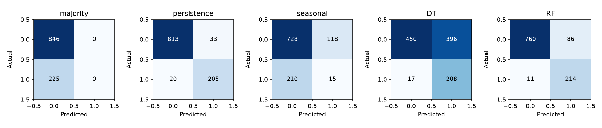
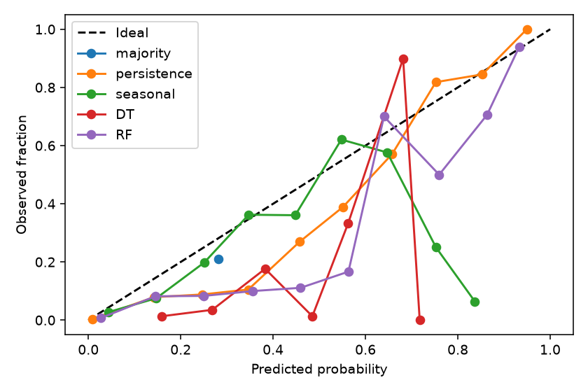

# ML evaluation

Generated by `npm run ml:evaluate`. Fixed seed 20261026. Source SHA-256: `4e993553f10081b4e6b35a0d4b3c9bd0cc271765645a123fcb2e0c5d7084633c`. All numbers come from saved evaluation and predictions; no prototype metrics are copied.

## Chronological 70:30 headline

{"train_weeks": 145, "test_weeks": 63, "train_start": "2016-07-17", "train_end": "2019-08-25", "test_start": "2019-09-01", "test_end": "2020-11-08", "train_rows": 2465, "test_rows": 1071, "split_axis": "distinct target weeks; all 17 cities share the same boundary"}

|Model|N / positives|accuracy|balanced_accuracy|precision|recall|f1|roc_auc|pr_auc|brier|
|---|---|---|---|---|---|---|---|---|---|
|majority|1071 / 225|0.7899 [0.6050, 0.9300]|0.5000 [0.5000, 0.5000]|0.0000 [0.0000, 0.0000]|0.0000 [0.0000, 0.0000]|0.0000 [0.0000, 0.0000]|0.5000 [0.5000, 0.5000]|0.2101 [0.0700, 0.3950]|0.1711 [0.1098, 0.2518]|
|persistence|1071 / 225|0.9505 [0.9047, 0.9841]|0.9361 [0.8513, 0.9799]|0.8613 [0.6309, 0.9608]|0.9111 [0.7374, 0.9730]|0.8855 [0.7049, 0.9630]|0.9865 [0.9540, 0.9984]|0.9593 [0.7999, 0.9944]|0.0388 [0.0131, 0.0699]|
|seasonal|1071 / 225|0.6937 [0.5349, 0.8229]|0.4636 [0.3927, 0.5376]|0.1128 [0.0000, 0.4724]|0.0667 [0.0000, 0.1621]|0.0838 [0.0000, 0.1936]|0.6986 [0.5339, 0.8631]|0.2808 [0.0891, 0.5941]|0.2063 [0.1131, 0.2924]|
|DT|1071 / 225|0.6144 [0.4669, 0.7443]|0.7282 [0.6233, 0.8136]|0.3444 [0.1290, 0.5809]|0.9244 [0.7650, 0.9906]|0.5018 [0.2258, 0.7225]|0.9334 [0.8270, 0.9826]|0.8366 [0.5427, 0.9479]|0.1449 [0.1186, 0.1711]|
|RF|1071 / 225|0.9094 [0.8243, 0.9720]|0.9247 [0.8334, 0.9791]|0.7133 [0.4161, 0.8984]|0.9511 [0.7924, 1.0000]|0.8152 [0.5307, 0.9401]|0.9803 [0.9292, 0.9984]|0.9523 [0.7024, 0.9937]|0.0445 [0.0133, 0.0856]|

Persistence clearly improves F1 over RF in this comparison.
RF minus persistence F1 paired 95% CI: [-0.15381622832094527, -0.01574025901559638]. The deployed method is chosen by validation, not by test results.

## Onset: cities below the threshold at forecast origin

|Model|N / positives|accuracy|balanced_accuracy|precision|recall|f1|roc_auc|pr_auc|brier|
|---|---|---|---|---|---|---|---|---|---|
|majority|833 / 20|0.9760 [0.9500, 0.9958]|0.5000 [0.5000, 0.5000]|0.0000 [0.0000, 0.0000]|0.0000 [0.0000, 0.0000]|0.0000 [0.0000, 0.0000]|0.5000 [0.5000, 0.5000]|0.0240 [0.0042, 0.0500]|0.0898 [0.0811, 0.1011]|
|persistence|833 / 20|0.9760 [0.9500, 0.9958]|0.5000 [0.5000, 0.5000]|0.0000 [0.0000, 0.0000]|0.0000 [0.0000, 0.0000]|0.0000 [0.0000, 0.0000]|0.9295 [0.8434, 0.9941]|0.2814 [0.1158, 0.5774]|0.0239 [0.0061, 0.0459]|
|seasonal|833 / 20|0.8343 [0.7031, 0.9403]|0.4274 [0.3666, 0.4811]|0.0000 [0.0000, 0.0000]|0.0000 [0.0000, 0.0000]|0.0000 [0.0000, 0.0000]|0.5545 [0.3286, 0.7436]|0.0265 [0.0063, 0.0763]|0.1965 [0.0929, 0.3233]|
|DT|833 / 20|0.5414 [0.3898, 0.6983]|0.4481 [0.3252, 0.6265]|0.0186 [0.0027, 0.0438]|0.3500 [0.0794, 0.7004]|0.0354 [0.0053, 0.0785]|0.5866 [0.4654, 0.7362]|0.1184 [0.0120, 0.3795]|0.1439 [0.1121, 0.1738]|
|RF|833 / 20|0.9232 [0.8409, 0.9806]|0.7168 [0.5442, 0.9360]|0.1562 [0.0417, 0.3277]|0.5000 [0.1427, 0.9170]|0.2381 [0.0701, 0.4212]|0.8641 [0.7271, 0.9905]|0.2922 [0.0516, 0.6557]|0.0290 [0.0074, 0.0586]|

Few onset positives make this exploratory early-warning evidence; interval widths matter. Repeated elevated weeks are an easier task than anticipating first onset.

## Random stratified 70:30 comparison

|Model|N / positives|accuracy|balanced_accuracy|precision|recall|f1|roc_auc|pr_auc|brier|
|---|---|---|---|---|---|---|---|---|---|
|majority|1061 / 276|0.7399 [0.6474, 0.8166]|0.5000 [0.5000, 0.5000]|0.0000 [0.0000, 0.0000]|0.0000 [0.0000, 0.0000]|0.0000 [0.0000, 0.0000]|0.5000 [0.5000, 0.5000]|0.2601 [0.1834, 0.3526]|0.1925 [0.1556, 0.2369]|
|persistence|1061 / 276|0.8558 [0.8035, 0.9050]|0.8062 [0.7457, 0.8672]|0.7321 [0.5950, 0.8431]|0.7029 [0.5861, 0.7969]|0.7172 [0.5995, 0.8158]|0.8755 [0.7849, 0.9461]|0.7516 [0.5952, 0.8875]|0.1088 [0.0774, 0.1439]|
|seasonal|1061 / 276|0.7229 [0.6458, 0.7976]|0.5073 [0.4790, 0.5351]|0.3200 [0.0839, 0.7620]|0.0580 [0.0127, 0.1050]|0.0982 [0.0230, 0.1744]|0.7868 [0.7101, 0.8618]|0.4612 [0.3233, 0.6719]|0.1619 [0.1297, 0.1953]|
|DT|1061 / 276|0.8662 [0.8239, 0.9048]|0.8590 [0.8148, 0.8943]|0.7018 [0.6046, 0.7905]|0.8442 [0.7530, 0.9058]|0.7664 [0.6733, 0.8364]|0.9274 [0.8891, 0.9573]|0.8204 [0.6991, 0.8945]|0.0872 [0.0645, 0.1118]|
|RF|1061 / 276|0.8718 [0.8284, 0.9181]|0.8711 [0.8231, 0.9110]|0.7059 [0.6086, 0.7901]|0.8696 [0.7894, 0.9267]|0.7792 [0.6950, 0.8469]|0.9469 [0.9153, 0.9715]|0.8776 [0.7669, 0.9380]|0.0793 [0.0567, 0.1012]|

This row-random comparison mixes earlier and later dates and correlated city/weeks; it is not the headline forecasting estimate. Its parameters are frozen from chronological training and calibration/operating points use a separate random-training validation subset.

## Rolling-origin yearly robustness

### 2018; training through 2017-12-31

|Model|N / positives|accuracy|balanced_accuracy|precision|recall|f1|roc_auc|pr_auc|brier|
|---|---|---|---|---|---|---|---|---|---|
|majority|884 / 263|0.7025 [0.5147, 0.8338]|0.5000 [0.5000, 0.5000]|0.0000 [0.0000, 0.0000]|0.0000 [0.0000, 0.0000]|0.0000 [0.0000, 0.0000]|0.5000 [0.5000, 0.5000]|0.2975 [0.1662, 0.4853]|0.2094 [0.1617, 0.2777]|
|persistence|884 / 263|0.8643 [0.8099, 0.9310]|0.8376 [0.7586, 0.9003]|0.7719 [0.6257, 0.8870]|0.7719 [0.6149, 0.8679]|0.7719 [0.6297, 0.8725]|0.9244 [0.8632, 0.9702]|0.8447 [0.6901, 0.9358]|0.1015 [0.0573, 0.1392]|
|seasonal|884 / 263|0.7172 [0.5406, 0.8418]|0.5477 [0.5023, 0.6097]|0.6182 [0.4921, 0.7667]|0.1293 [0.0065, 0.2823]|0.2138 [0.0128, 0.3771]|0.8613 [0.7759, 0.9320]|0.6531 [0.5164, 0.8185]|0.1434 [0.0922, 0.1913]|
|DT|884 / 263|0.8326 [0.7749, 0.9051]|0.7844 [0.6794, 0.8665]|0.7447 [0.5331, 0.8708]|0.6654 [0.4398, 0.8374]|0.7028 [0.4874, 0.8313]|0.8941 [0.8045, 0.9536]|0.7731 [0.5886, 0.8809]|0.1678 [0.1171, 0.2301]|
|RF|884 / 263|0.8541 [0.7952, 0.9253]|0.8413 [0.7619, 0.9123]|0.7295 [0.5890, 0.8561]|0.8099 [0.5858, 0.9330]|0.7676 [0.6358, 0.8734]|0.9257 [0.8687, 0.9716]|0.8433 [0.7021, 0.9331]|0.1175 [0.0693, 0.1646]|

### 2019; training through 2018-12-30

|Model|N / positives|accuracy|balanced_accuracy|precision|recall|f1|roc_auc|pr_auc|brier|
|---|---|---|---|---|---|---|---|---|---|
|majority|731 / 271|0.6293 [0.3815, 0.8140]|0.5000 [0.5000, 0.5000]|0.0000 [0.0000, 0.0000]|0.0000 [0.0000, 0.0000]|0.0000 [0.0000, 0.0000]|0.5000 [0.5000, 0.5000]|0.3707 [0.1860, 0.6185]|0.2371 [0.1666, 0.3316]|
|persistence|731 / 271|0.9248 [0.8618, 0.9700]|0.9182 [0.8448, 0.9681]|0.9030 [0.8089, 0.9805]|0.8930 [0.7442, 0.9667]|0.8980 [0.7867, 0.9600]|0.9772 [0.9363, 0.9962]|0.9672 [0.8930, 0.9936]|0.0570 [0.0272, 0.0963]|
|seasonal|731 / 271|0.6703 [0.4673, 0.8359]|0.5591 [0.5024, 0.6248]|0.8750 [0.4241, 1.0000]|0.1292 [0.0077, 0.2609]|0.2251 [0.0150, 0.4002]|0.9060 [0.7995, 0.9564]|0.8164 [0.6146, 0.9339]|0.1290 [0.0792, 0.1910]|
|DT|731 / 271|0.8796 [0.7932, 0.9550]|0.8998 [0.7980, 0.9619]|0.7637 [0.6074, 0.9141]|0.9779 [0.9279, 1.0000]|0.8576 [0.7411, 0.9498]|0.9652 [0.9122, 0.9915]|0.9116 [0.8033, 0.9831]|0.0940 [0.0618, 0.1373]|
|RF|731 / 271|0.9001 [0.8153, 0.9673]|0.9108 [0.8202, 0.9690]|0.8113 [0.6472, 0.9664]|0.9520 [0.8526, 0.9967]|0.8761 [0.7620, 0.9591]|0.9771 [0.9287, 0.9968]|0.9620 [0.8614, 0.9939]|0.0614 [0.0242, 0.1096]|

### 2020; training through 2019-12-29

|Model|N / positives|accuracy|balanced_accuracy|precision|recall|f1|roc_auc|pr_auc|brier|
|---|---|---|---|---|---|---|---|---|---|
|majority|765 / 17|0.9778 [0.9294, 1.0000]|0.5000 [0.5000, 0.5000]|0.0000 [0.0000, 0.0000]|0.0000 [0.0000, 0.0000]|0.0000 [0.0000, 0.0000]|0.5000 [0.5000, 0.5000]|0.0222 [0.0026, 0.0717]|0.1137 [0.1060, 0.1306]|
|persistence|765 / 17|0.9725 [0.9189, 1.0000]|0.6985 [0.4993, 0.8471]|0.3889 [0.0000, 0.5738]|0.4118 [0.0000, 0.7143]|0.4000 [0.0000, 0.4667]|0.9494 [0.8785, 0.9933]|0.4614 [0.0564, 0.6117]|0.0215 [0.0012, 0.0585]|
|seasonal|765 / 17|0.8235 [0.6941, 0.9361]|0.4211 [0.3545, 0.4843]|0.0000 [0.0000, 0.0000]|0.0000 [0.0000, 0.0000]|0.0000 [0.0000, 0.0000]|0.5366 [0.3490, 0.7302]|0.0236 [0.0052, 0.0879]|0.2362 [0.1045, 0.3797]|
|DT|765 / 17|0.9752 [0.9255, 1.0000]|0.6424 [0.4993, 0.7798]|0.4167 [0.0000, 0.5556]|0.2941 [0.0000, 0.5714]|0.3448 [0.0000, 0.4444]|0.6823 [0.3004, 0.9283]|0.1983 [0.0026, 0.2910]|0.0404 [0.0195, 0.0723]|
|RF|765 / 17|0.9712 [0.9137, 1.0000]|0.6116 [0.4975, 0.7777]|0.3077 [0.0000, 0.4444]|0.2353 [0.0000, 0.5714]|0.2667 [0.0000, 0.3905]|0.8874 [0.7714, 0.9884]|0.3011 [0.0128, 0.5052]|0.0197 [0.0010, 0.0577]|

## Label sensitivity

Each definition refits models and calibration on its training portion only, using frozen headline training-selected hyperparameters. These nine predeclared definitions do not select a preferred test result.

### SD multiplier 0.5; minimum 5

|Model|N / positives|accuracy|balanced_accuracy|precision|recall|f1|roc_auc|pr_auc|brier|
|---|---|---|---|---|---|---|---|---|---|
|majority|1071 / 282|0.7367 [0.5669, 0.8752]|0.5000 [0.5000, 0.5000]|0.0000 [0.0000, 0.0000]|0.0000 [0.0000, 0.0000]|0.0000 [0.0000, 0.0000]|0.5000 [0.5000, 0.5000]|0.2633 [0.1248, 0.4331]|0.2075 [0.1742, 0.2484]|
|persistence|1071 / 282|0.9402 [0.9010, 0.9762]|0.9321 [0.8701, 0.9730]|0.8658 [0.7235, 0.9465]|0.9149 [0.7866, 0.9799]|0.8897 [0.7749, 0.9600]|0.9844 [0.9598, 0.9970]|0.9628 [0.8693, 0.9939]|0.0447 [0.0191, 0.0734]|
|seasonal|1071 / 282|0.6200 [0.4518, 0.7711]|0.5279 [0.3986, 0.6441]|0.3003 [0.0782, 0.7160]|0.3333 [0.0932, 0.4880]|0.3160 [0.0882, 0.5114]|0.6573 [0.4757, 0.8353]|0.3124 [0.1531, 0.6584]|0.2634 [0.1481, 0.3678]|
|DT|1071 / 282|0.9094 [0.8486, 0.9617]|0.8838 [0.7410, 0.9627]|0.8269 [0.6065, 0.9502]|0.8298 [0.5482, 0.9816]|0.8283 [0.6030, 0.9469]|0.9397 [0.8824, 0.9767]|0.8574 [0.6254, 0.9551]|0.1303 [0.1114, 0.1523]|
|RF|1071 / 282|0.9122 [0.8533, 0.9650]|0.9222 [0.8640, 0.9708]|0.7733 [0.5713, 0.9087]|0.9433 [0.8413, 0.9932]|0.8498 [0.6979, 0.9492]|0.9773 [0.9437, 0.9939]|0.9529 [0.8369, 0.9901]|0.0604 [0.0294, 0.0975]|

### SD multiplier 0.5; minimum 10

|Model|N / positives|accuracy|balanced_accuracy|precision|recall|f1|roc_auc|pr_auc|brier|
|---|---|---|---|---|---|---|---|---|---|
|majority|1071 / 279|0.7395 [0.5689, 0.8771]|0.5000 [0.5000, 0.5000]|0.0000 [0.0000, 0.0000]|0.0000 [0.0000, 0.0000]|0.0000 [0.0000, 0.0000]|0.5000 [0.5000, 0.5000]|0.2605 [0.1229, 0.4311]|0.2013 [0.1611, 0.2512]|
|persistence|1071 / 279|0.9356 [0.8945, 0.9715]|0.9251 [0.8611, 0.9684]|0.8571 [0.7059, 0.9423]|0.9032 [0.7730, 0.9700]|0.8796 [0.7577, 0.9546]|0.9825 [0.9549, 0.9963]|0.9563 [0.8459, 0.9919]|0.0463 [0.0206, 0.0762]|
|seasonal|1071 / 279|0.6172 [0.4436, 0.7688]|0.5160 [0.3934, 0.6282]|0.2824 [0.0690, 0.6970]|0.3047 [0.0808, 0.4547]|0.2931 [0.0782, 0.4767]|0.6580 [0.4773, 0.8376]|0.3104 [0.1529, 0.6499]|0.2626 [0.1458, 0.3683]|
|DT|1071 / 279|0.8945 [0.8224, 0.9539]|0.9008 [0.8233, 0.9565]|0.7413 [0.5072, 0.8907]|0.9140 [0.7937, 0.9821]|0.8186 [0.6256, 0.9349]|0.9159 [0.8315, 0.9722]|0.8324 [0.5771, 0.9568]|0.1540 [0.1277, 0.1843]|
|RF|1071 / 279|0.9066 [0.8412, 0.9646]|0.9148 [0.8469, 0.9689]|0.7625 [0.5385, 0.9073]|0.9319 [0.8228, 0.9911]|0.8387 [0.6682, 0.9473]|0.9734 [0.9364, 0.9916]|0.9470 [0.8204, 0.9883]|0.0606 [0.0282, 0.0978]|

### SD multiplier 0.5; minimum 20

|Model|N / positives|accuracy|balanced_accuracy|precision|recall|f1|roc_auc|pr_auc|brier|
|---|---|---|---|---|---|---|---|---|---|
|majority|1071 / 248|0.7684 [0.6087, 0.8938]|0.5000 [0.5000, 0.5000]|0.0000 [0.0000, 0.0000]|0.0000 [0.0000, 0.0000]|0.0000 [0.0000, 0.0000]|0.5000 [0.5000, 0.5000]|0.2316 [0.1062, 0.3913]|0.1786 [0.1176, 0.2563]|
|persistence|1071 / 248|0.9272 [0.8870, 0.9651]|0.9075 [0.8372, 0.9435]|0.8244 [0.6841, 0.9046]|0.8710 [0.7359, 0.9355]|0.8471 [0.7256, 0.9144]|0.9771 [0.9529, 0.9928]|0.9397 [0.8257, 0.9801]|0.0509 [0.0245, 0.0804]|
|seasonal|1071 / 248|0.6648 [0.5122, 0.7909]|0.5269 [0.4284, 0.6120]|0.2735 [0.0710, 0.6900]|0.2702 [0.0802, 0.4092]|0.2718 [0.0773, 0.4470]|0.6975 [0.5562, 0.8585]|0.3077 [0.1486, 0.6394]|0.2467 [0.1291, 0.3445]|
|DT|1071 / 248|0.9160 [0.8631, 0.9595]|0.8946 [0.8119, 0.9434]|0.7970 [0.6248, 0.9044]|0.8548 [0.6932, 0.9356]|0.8249 [0.6852, 0.9027]|0.9577 [0.8960, 0.9904]|0.9005 [0.7380, 0.9698]|0.0842 [0.0541, 0.1150]|
|RF|1071 / 248|0.8954 [0.8308, 0.9482]|0.8925 [0.8184, 0.9449]|0.7237 [0.5251, 0.8548]|0.8871 [0.7669, 0.9614]|0.7971 [0.6389, 0.8966]|0.9672 [0.9269, 0.9884]|0.9265 [0.7839, 0.9775]|0.0644 [0.0310, 0.1051]|

### SD multiplier 1.0; minimum 5

|Model|N / positives|accuracy|balanced_accuracy|precision|recall|f1|roc_auc|pr_auc|brier|
|---|---|---|---|---|---|---|---|---|---|
|majority|1071 / 225|0.7899 [0.6099, 0.9199]|0.5000 [0.5000, 0.5000]|0.0000 [0.0000, 0.0000]|0.0000 [0.0000, 0.0000]|0.0000 [0.0000, 0.0000]|0.5000 [0.5000, 0.5000]|0.2101 [0.0801, 0.3901]|0.1724 [0.1179, 0.2478]|
|persistence|1071 / 225|0.9505 [0.9145, 0.9781]|0.9361 [0.8659, 0.9723]|0.8613 [0.6793, 0.9489]|0.9111 [0.7679, 0.9685]|0.8855 [0.7348, 0.9567]|0.9865 [0.9602, 0.9968]|0.9593 [0.8172, 0.9920]|0.0391 [0.0182, 0.0647]|
|seasonal|1071 / 225|0.6937 [0.5289, 0.8353]|0.4636 [0.3885, 0.5430]|0.1128 [0.0000, 0.4458]|0.0667 [0.0000, 0.1627]|0.0838 [0.0000, 0.1849]|0.6986 [0.5231, 0.8571]|0.2808 [0.1234, 0.6331]|0.2081 [0.1130, 0.2998]|
|DT|1071 / 225|0.9234 [0.8828, 0.9603]|0.9108 [0.8158, 0.9600]|0.7782 [0.5328, 0.9040]|0.8889 [0.6988, 0.9688]|0.8299 [0.6162, 0.9364]|0.9561 [0.8723, 0.9868]|0.8883 [0.6408, 0.9705]|0.0865 [0.0646, 0.1122]|
|RF|1071 / 225|0.9076 [0.8267, 0.9678]|0.9268 [0.8579, 0.9733]|0.7059 [0.4463, 0.8831]|0.9600 [0.8196, 1.0000]|0.8136 [0.5995, 0.9279]|0.9808 [0.9363, 0.9968]|0.9507 [0.7649, 0.9918]|0.0481 [0.0189, 0.0868]|

### SD multiplier 1.0; minimum 10

|Model|N / positives|accuracy|balanced_accuracy|precision|recall|f1|roc_auc|pr_auc|brier|
|---|---|---|---|---|---|---|---|---|---|
|majority|1071 / 225|0.7899 [0.6050, 0.9300]|0.5000 [0.5000, 0.5000]|0.0000 [0.0000, 0.0000]|0.0000 [0.0000, 0.0000]|0.0000 [0.0000, 0.0000]|0.5000 [0.5000, 0.5000]|0.2101 [0.0700, 0.3950]|0.1711 [0.1098, 0.2518]|
|persistence|1071 / 225|0.9505 [0.9047, 0.9841]|0.9361 [0.8513, 0.9799]|0.8613 [0.6309, 0.9608]|0.9111 [0.7374, 0.9730]|0.8855 [0.7049, 0.9630]|0.9865 [0.9540, 0.9984]|0.9593 [0.7999, 0.9944]|0.0388 [0.0131, 0.0699]|
|seasonal|1071 / 225|0.6937 [0.5349, 0.8229]|0.4636 [0.3927, 0.5376]|0.1128 [0.0000, 0.4724]|0.0667 [0.0000, 0.1621]|0.0838 [0.0000, 0.1936]|0.6986 [0.5339, 0.8631]|0.2808 [0.0891, 0.5941]|0.2063 [0.1131, 0.2924]|
|DT|1071 / 225|0.6144 [0.4669, 0.7443]|0.7282 [0.6233, 0.8136]|0.3444 [0.1290, 0.5809]|0.9244 [0.7650, 0.9906]|0.5018 [0.2258, 0.7225]|0.9334 [0.8270, 0.9826]|0.8366 [0.5427, 0.9479]|0.1449 [0.1186, 0.1711]|
|RF|1071 / 225|0.9094 [0.8243, 0.9720]|0.9247 [0.8334, 0.9791]|0.7133 [0.4161, 0.8984]|0.9511 [0.7924, 1.0000]|0.8152 [0.5307, 0.9401]|0.9803 [0.9292, 0.9984]|0.9523 [0.7024, 0.9937]|0.0445 [0.0133, 0.0856]|

### SD multiplier 1.0; minimum 20

|Model|N / positives|accuracy|balanced_accuracy|precision|recall|f1|roc_auc|pr_auc|brier|
|---|---|---|---|---|---|---|---|---|---|
|majority|1071 / 203|0.8105 [0.6429, 0.9303]|0.5000 [0.5000, 0.5000]|0.0000 [0.0000, 0.0000]|0.0000 [0.0000, 0.0000]|0.0000 [0.0000, 0.0000]|0.5000 [0.5000, 0.5000]|0.1895 [0.0697, 0.3571]|0.1541 [0.0852, 0.2505]|
|persistence|1071 / 203|0.9384 [0.8987, 0.9679]|0.9129 [0.8398, 0.9475]|0.8157 [0.6167, 0.9026]|0.8719 [0.7206, 0.9345]|0.8429 [0.6740, 0.9139]|0.9809 [0.9529, 0.9930]|0.9387 [0.7872, 0.9781]|0.0436 [0.0225, 0.0696]|
|seasonal|1071 / 203|0.7246 [0.5732, 0.8582]|0.4678 [0.4033, 0.5366]|0.0965 [0.0000, 0.3717]|0.0542 [0.0000, 0.1374]|0.0694 [0.0000, 0.1604]|0.7137 [0.5603, 0.8586]|0.2688 [0.1114, 0.6070]|0.2043 [0.1067, 0.2941]|
|DT|1071 / 203|0.8702 [0.8025, 0.9212]|0.8860 [0.8060, 0.9294]|0.6046 [0.3173, 0.7804]|0.9113 [0.7461, 0.9797]|0.7269 [0.4531, 0.8554]|0.9398 [0.8454, 0.9763]|0.8252 [0.5698, 0.9225]|0.0815 [0.0553, 0.1089]|
|RF|1071 / 203|0.9160 [0.8575, 0.9655]|0.9123 [0.8363, 0.9575]|0.7216 [0.4716, 0.8624]|0.9064 [0.7461, 0.9765]|0.8035 [0.5931, 0.9093]|0.9707 [0.9302, 0.9918]|0.9264 [0.7390, 0.9767]|0.0518 [0.0242, 0.0866]|

### SD multiplier 1.5; minimum 5

|Model|N / positives|accuracy|balanced_accuracy|precision|recall|f1|roc_auc|pr_auc|brier|
|---|---|---|---|---|---|---|---|---|---|
|majority|1071 / 183|0.8291 [0.6648, 0.9444]|0.5000 [0.5000, 0.5000]|0.0000 [0.0000, 0.0000]|0.0000 [0.0000, 0.0000]|0.0000 [0.0000, 0.0000]|0.5000 [0.5000, 0.5000]|0.1709 [0.0556, 0.3352]|0.1436 [0.0778, 0.2374]|
|persistence|1071 / 183|0.9468 [0.9124, 0.9753]|0.9202 [0.8555, 0.9493]|0.8214 [0.6291, 0.8988]|0.8798 [0.7471, 0.9334]|0.8496 [0.6801, 0.9137]|0.9849 [0.9652, 0.9949]|0.9392 [0.7513, 0.9759]|0.0373 [0.0182, 0.0603]|
|seasonal|1071 / 183|0.8217 [0.6580, 0.9397]|0.4955 [0.4895, 0.5000]|0.0000 [0.0000, 0.0000]|0.0000 [0.0000, 0.0000]|0.0000 [0.0000, 0.0000]|0.7162 [0.5423, 0.8656]|0.2462 [0.0920, 0.5717]|0.1640 [0.0926, 0.2400]|
|DT|1071 / 183|0.9318 [0.8892, 0.9650]|0.9329 [0.8790, 0.9634]|0.7371 [0.5114, 0.8614]|0.9344 [0.8199, 0.9821]|0.8241 [0.6457, 0.9024]|0.9582 [0.8778, 0.9864]|0.8409 [0.6129, 0.9286]|0.0808 [0.0530, 0.1144]|
|RF|1071 / 183|0.9197 [0.8419, 0.9707]|0.9364 [0.8737, 0.9732]|0.6902 [0.4284, 0.8635]|0.9617 [0.8259, 1.0000]|0.8037 [0.5750, 0.9123]|0.9791 [0.9388, 0.9937]|0.9346 [0.7412, 0.9728]|0.0436 [0.0190, 0.0776]|

### SD multiplier 1.5; minimum 10

|Model|N / positives|accuracy|balanced_accuracy|precision|recall|f1|roc_auc|pr_auc|brier|
|---|---|---|---|---|---|---|---|---|---|
|majority|1071 / 183|0.8291 [0.6648, 0.9444]|0.5000 [0.5000, 0.5000]|0.0000 [0.0000, 0.0000]|0.0000 [0.0000, 0.0000]|0.0000 [0.0000, 0.0000]|0.5000 [0.5000, 0.5000]|0.1709 [0.0556, 0.3352]|0.1434 [0.0772, 0.2379]|
|persistence|1071 / 183|0.9468 [0.9124, 0.9753]|0.9202 [0.8555, 0.9493]|0.8214 [0.6291, 0.8988]|0.8798 [0.7471, 0.9334]|0.8496 [0.6801, 0.9137]|0.9849 [0.9652, 0.9949]|0.9392 [0.7513, 0.9759]|0.0372 [0.0182, 0.0602]|
|seasonal|1071 / 183|0.8217 [0.6580, 0.9397]|0.4955 [0.4895, 0.5000]|0.0000 [0.0000, 0.0000]|0.0000 [0.0000, 0.0000]|0.0000 [0.0000, 0.0000]|0.7162 [0.5423, 0.8656]|0.2462 [0.0920, 0.5717]|0.1637 [0.0925, 0.2395]|
|DT|1071 / 183|0.9458 [0.9101, 0.9757]|0.9196 [0.8290, 0.9620]|0.8173 [0.6198, 0.8971]|0.8798 [0.7068, 0.9569]|0.8474 [0.6463, 0.9209]|0.9480 [0.8733, 0.9782]|0.8246 [0.5237, 0.9231]|0.1020 [0.0717, 0.1407]|
|RF|1071 / 183|0.8721 [0.7654, 0.9507]|0.9120 [0.8403, 0.9558]|0.5742 [0.3014, 0.7924]|0.9727 [0.8838, 1.0000]|0.7221 [0.4595, 0.8667]|0.9768 [0.9337, 0.9927]|0.9272 [0.7084, 0.9691]|0.0440 [0.0198, 0.0770]|

### SD multiplier 1.5; minimum 20

|Model|N / positives|accuracy|balanced_accuracy|precision|recall|f1|roc_auc|pr_auc|brier|
|---|---|---|---|---|---|---|---|---|---|
|majority|1071 / 174|0.8375 [0.6787, 0.9476]|0.5000 [0.5000, 0.5000]|0.0000 [0.0000, 0.0000]|0.0000 [0.0000, 0.0000]|0.0000 [0.0000, 0.0000]|0.5000 [0.5000, 0.5000]|0.1625 [0.0524, 0.3213]|0.1361 [0.0634, 0.2411]|
|persistence|1071 / 174|0.9421 [0.9071, 0.9734]|0.9099 [0.8387, 0.9357]|0.7979 [0.5869, 0.8740]|0.8621 [0.7121, 0.9131]|0.8287 [0.6407, 0.8868]|0.9814 [0.9597, 0.9929]|0.9282 [0.7083, 0.9673]|0.0392 [0.0182, 0.0626]|
|seasonal|1071 / 174|0.8301 [0.6719, 0.9434]|0.4955 [0.4896, 0.5000]|0.0000 [0.0000, 0.0000]|0.0000 [0.0000, 0.0000]|0.0000 [0.0000, 0.0000]|0.7180 [0.5541, 0.8646]|0.2374 [0.0855, 0.5532]|0.1625 [0.0892, 0.2358]|
|DT|1071 / 174|0.5714 [0.4191, 0.7349]|0.7256 [0.6280, 0.8076]|0.2690 [0.0891, 0.5043]|0.9540 [0.8291, 1.0000]|0.4197 [0.1614, 0.6651]|0.9032 [0.7776, 0.9485]|0.7662 [0.4738, 0.8671]|0.1078 [0.0788, 0.1394]|
|RF|1071 / 174|0.9094 [0.8341, 0.9659]|0.9205 [0.8577, 0.9596]|0.6546 [0.3754, 0.8292]|0.9368 [0.7924, 0.9920]|0.7707 [0.5264, 0.8776]|0.9702 [0.9260, 0.9887]|0.9073 [0.6486, 0.9566]|0.0463 [0.0207, 0.0750]|

## Per-city results (Manila included)

### CALOOCAN CITY

|Model|N / positives|accuracy|balanced_accuracy|precision|recall|f1|roc_auc|pr_auc|brier|
|---|---|---|---|---|---|---|---|---|---|
|majority|63 / 8|0.8730 [0.6825, 1.0000]|0.5000 [0.5000, 0.5000]|0.0000 [0.0000, 0.0000]|0.0000 [0.0000, 0.0000]|0.0000 [0.0000, 0.0000]|0.5000 [0.5000, 0.5000]|0.1270 [0.0317, 0.3175]|0.1347 [0.0793, 0.2180]|
|persistence|63 / 8|0.9841 [0.9524, 1.0000]|0.9909 [0.9698, 1.0000]|0.8889 [0.0000, 1.0000]|1.0000 [0.0000, 1.0000]|0.9412 [0.0000, 1.0000]|1.0000 [1.0000, 1.0000]|1.0000 [1.0000, 1.0000]|0.0193 [0.0032, 0.0440]|
|seasonal|63 / 8|0.7460 [0.5552, 0.9206]|0.4807 [0.3475, 0.7029]|0.1000 [0.0000, 0.5556]|0.1250 [0.0000, 0.5000]|0.1111 [0.0000, 0.3756]|0.7591 [0.5810, 0.9426]|0.2343 [0.0738, 0.7226]|0.2073 [0.1044, 0.3059]|
|DT|63 / 8|0.5238 [0.3643, 0.6825]|0.7273 [0.6078, 0.8149]|0.2105 [0.0000, 0.4569]|1.0000 [0.0000, 1.0000]|0.3478 [0.0000, 0.6272]|0.9909 [0.9698, 1.0000]|0.8889 [0.5649, 1.0000]|0.1520 [0.1215, 0.1849]|
|RF|63 / 8|0.8889 [0.7302, 0.9845]|0.9364 [0.8421, 0.9936]|0.5333 [0.0000, 0.9391]|1.0000 [0.0000, 1.0000]|0.6957 [0.0000, 0.9685]|1.0000 [1.0000, 1.0000]|1.0000 [1.0000, 1.0000]|0.0387 [0.0065, 0.0876]|

### LAS PINAS CITY

|Model|N / positives|accuracy|balanced_accuracy|precision|recall|f1|roc_auc|pr_auc|brier|
|---|---|---|---|---|---|---|---|---|---|
|majority|63 / 15|0.7619 [0.5710, 0.9206]|0.5000 [0.5000, 0.5000]|0.0000 [0.0000, 0.0000]|0.0000 [0.0000, 0.0000]|0.0000 [0.0000, 0.0000]|0.5000 [0.5000, 0.5000]|0.2381 [0.0794, 0.4294]|0.1833 [0.1139, 0.2667]|
|persistence|63 / 15|0.9524 [0.8889, 1.0000]|0.9458 [0.8566, 1.0000]|0.8750 [0.6917, 1.0000]|0.9333 [0.7269, 1.0000]|0.9032 [0.7613, 1.0000]|0.9833 [0.9426, 1.0000]|0.9528 [0.7644, 1.0000]|0.0403 [0.0066, 0.0847]|
|seasonal|63 / 15|0.6667 [0.4921, 0.8571]|0.4375 [0.3592, 0.5000]|0.0000 [0.0000, 0.0000]|0.0000 [0.0000, 0.0000]|0.0000 [0.0000, 0.0000]|0.6778 [0.4720, 0.8875]|0.3149 [0.1395, 0.6721]|0.2197 [0.1262, 0.3032]|
|DT|63 / 15|0.6190 [0.4595, 0.7778]|0.6813 [0.4638, 0.8322]|0.3636 [0.0947, 0.6177]|0.8000 [0.3747, 1.0000]|0.5000 [0.1658, 0.7421]|0.8201 [0.4527, 1.0000]|0.7899 [0.4370, 1.0000]|0.1574 [0.1088, 0.2138]|
|RF|63 / 15|0.9048 [0.7937, 0.9841]|0.9146 [0.8121, 0.9894]|0.7368 [0.3557, 1.0000]|0.9333 [0.7269, 1.0000]|0.8235 [0.4990, 0.9715]|0.9806 [0.9212, 1.0000]|0.9521 [0.7911, 1.0000]|0.0488 [0.0066, 0.1101]|

### MAKATI CITY

|Model|N / positives|accuracy|balanced_accuracy|precision|recall|f1|roc_auc|pr_auc|brier|
|---|---|---|---|---|---|---|---|---|---|
|majority|63 / 11|0.8254 [0.6349, 0.9528]|0.5000 [0.5000, 0.5000]|0.0000 [0.0000, 0.0000]|0.0000 [0.0000, 0.0000]|0.0000 [0.0000, 0.0000]|0.5000 [0.5000, 0.5000]|0.1746 [0.0615, 0.3651]|0.1556 [0.0999, 0.2388]|
|persistence|63 / 11|0.9841 [0.9524, 1.0000]|0.9904 [0.9667, 1.0000]|0.9167 [0.6650, 1.0000]|1.0000 [1.0000, 1.0000]|0.9565 [0.7988, 1.0000]|1.0000 [1.0000, 1.0000]|1.0000 [1.0000, 1.0000]|0.0296 [0.0064, 0.0611]|
|seasonal|63 / 11|0.7302 [0.5397, 0.9048]|0.5140 [0.3699, 0.7668]|0.2000 [0.0000, 0.8584]|0.1818 [0.0000, 0.6667]|0.1905 [0.0000, 0.5714]|0.7500 [0.5584, 0.9419]|0.2971 [0.1269, 0.7750]|0.2019 [0.1001, 0.3032]|
|DT|63 / 11|0.6032 [0.4286, 0.7460]|0.7596 [0.6596, 0.8408]|0.3056 [0.0827, 0.5244]|1.0000 [1.0000, 1.0000]|0.4681 [0.1528, 0.6880]|0.9904 [0.9667, 1.0000]|0.9167 [0.7125, 1.0000]|0.1464 [0.1153, 0.1780]|
|RF|63 / 11|0.8730 [0.7460, 0.9683]|0.9231 [0.8454, 0.9808]|0.5789 [0.2097, 0.8753]|1.0000 [1.0000, 1.0000]|0.7333 [0.3466, 0.9335]|1.0000 [1.0000, 1.0000]|1.0000 [1.0000, 1.0000]|0.0382 [0.0071, 0.0799]|

### MALABON CITY

|Model|N / positives|accuracy|balanced_accuracy|precision|recall|f1|roc_auc|pr_auc|brier|
|---|---|---|---|---|---|---|---|---|---|
|majority|63 / 13|0.7937 [0.6028, 0.9369]|0.5000 [0.5000, 0.5000]|0.0000 [0.0000, 0.0000]|0.0000 [0.0000, 0.0000]|0.0000 [0.0000, 0.0000]|0.5000 [0.5000, 0.5000]|0.2063 [0.0635, 0.3980]|0.1694 [0.1068, 0.2528]|
|persistence|63 / 13|0.9841 [0.9524, 1.0000]|0.9900 [0.9615, 1.0000]|0.9286 [0.6659, 1.0000]|1.0000 [1.0000, 1.0000]|0.9630 [0.7994, 1.0000]|0.9969 [0.9795, 1.0000]|0.9886 [0.9156, 1.0000]|0.0236 [0.0026, 0.0506]|
|seasonal|63 / 13|0.6825 [0.4444, 0.8730]|0.5154 [0.3640, 0.8132]|0.2308 [0.0000, 0.7152]|0.2308 [0.0000, 0.7869]|0.2308 [0.0000, 0.6435]|0.7646 [0.5549, 0.9532]|0.3414 [0.1532, 0.8393]|0.1808 [0.0819, 0.2908]|
|DT|63 / 13|0.6349 [0.4444, 0.7778]|0.7700 [0.6568, 0.8601]|0.3611 [0.1030, 0.6155]|1.0000 [1.0000, 1.0000]|0.5306 [0.1867, 0.7620]|0.9900 [0.9615, 1.0000]|0.9286 [0.6667, 1.0000]|0.1380 [0.1088, 0.1748]|
|RF|63 / 13|0.9048 [0.7937, 1.0000]|0.9400 [0.8677, 1.0000]|0.6842 [0.2587, 1.0000]|1.0000 [1.0000, 1.0000]|0.8125 [0.4110, 1.0000]|0.9969 [0.9795, 1.0000]|0.9886 [0.9155, 1.0000]|0.0258 [0.0017, 0.0597]|

### MANDALUYONG CITY

|Model|N / positives|accuracy|balanced_accuracy|precision|recall|f1|roc_auc|pr_auc|brier|
|---|---|---|---|---|---|---|---|---|---|
|majority|63 / 11|0.8254 [0.6504, 0.9683]|0.5000 [0.5000, 0.5000]|0.0000 [0.0000, 0.0000]|0.0000 [0.0000, 0.0000]|0.0000 [0.0000, 0.0000]|0.5000 [0.5000, 0.5000]|0.1746 [0.0317, 0.3504]|0.1556 [0.0931, 0.2320]|
|persistence|63 / 11|0.9365 [0.8726, 0.9841]|0.8899 [0.7412, 0.9909]|0.8182 [0.3333, 1.0000]|0.8182 [0.4958, 1.0000]|0.8182 [0.4000, 0.9547]|0.9441 [0.7984, 1.0000]|0.8843 [0.5829, 1.0000]|0.0568 [0.0161, 0.1032]|
|seasonal|63 / 11|0.8095 [0.6190, 0.9524]|0.4904 [0.4730, 0.5000]|0.0000 [0.0000, 0.0000]|0.0000 [0.0000, 0.0000]|0.0000 [0.0000, 0.0000]|0.7605 [0.5886, 0.9434]|0.2997 [0.1007, 0.7467]|0.1833 [0.1038, 0.2581]|
|DT|63 / 11|0.6190 [0.4599, 0.7619]|0.7692 [0.6664, 0.8472]|0.3143 [0.0687, 0.5299]|1.0000 [1.0000, 1.0000]|0.4783 [0.1286, 0.6927]|0.9843 [0.9537, 1.0000]|0.8721 [0.5851, 1.0000]|0.1410 [0.1096, 0.1742]|
|RF|63 / 11|0.8571 [0.6984, 0.9841]|0.8418 [0.5860, 0.9902]|0.5625 [0.0765, 0.9391]|0.8182 [0.2961, 1.0000]|0.6667 [0.1325, 0.9477]|0.9283 [0.7159, 1.0000]|0.8333 [0.3208, 1.0000]|0.0812 [0.0119, 0.1656]|

### MANILA CITY

|Model|N / positives|accuracy|balanced_accuracy|precision|recall|f1|roc_auc|pr_auc|brier|
|---|---|---|---|---|---|---|---|---|---|
|majority|63 / 13|0.7937 [0.6028, 0.9369]|0.5000 [0.5000, 0.5000]|0.0000 [0.0000, 0.0000]|0.0000 [0.0000, 0.0000]|0.0000 [0.0000, 0.0000]|0.5000 [0.5000, 0.5000]|0.2063 [0.0635, 0.3980]|0.1694 [0.1068, 0.2528]|
|persistence|63 / 13|0.9841 [0.9524, 1.0000]|0.9900 [0.9615, 1.0000]|0.9286 [0.6659, 1.0000]|1.0000 [1.0000, 1.0000]|0.9630 [0.7994, 1.0000]|0.9985 [0.9894, 1.0000]|0.9945 [0.9513, 1.0000]|0.0254 [0.0047, 0.0546]|
|seasonal|63 / 13|0.6508 [0.4286, 0.8254]|0.4669 [0.3327, 0.6167]|0.1538 [0.0000, 0.7513]|0.1538 [0.0000, 0.3750]|0.1538 [0.0000, 0.3530]|0.7569 [0.5334, 0.9410]|0.3358 [0.1406, 0.7685]|0.1995 [0.1000, 0.3005]|
|DT|63 / 13|0.6032 [0.4286, 0.7464]|0.7215 [0.5996, 0.8379]|0.3333 [0.0830, 0.5834]|0.9231 [0.7143, 1.0000]|0.4898 [0.1531, 0.7236]|0.9508 [0.8538, 1.0000]|0.8771 [0.6178, 1.0000]|0.1441 [0.1159, 0.1763]|
|RF|63 / 13|0.9365 [0.8567, 1.0000]|0.9600 [0.8970, 1.0000]|0.7647 [0.3327, 1.0000]|1.0000 [1.0000, 1.0000]|0.8667 [0.4993, 1.0000]|0.9985 [0.9894, 1.0000]|0.9945 [0.9513, 1.0000]|0.0261 [0.0020, 0.0633]|

### MARIKINA CITY

|Model|N / positives|accuracy|balanced_accuracy|precision|recall|f1|roc_auc|pr_auc|brier|
|---|---|---|---|---|---|---|---|---|---|
|majority|63 / 14|0.7778 [0.5873, 0.9206]|0.5000 [0.5000, 0.5000]|0.0000 [0.0000, 0.0000]|0.0000 [0.0000, 0.0000]|0.0000 [0.0000, 0.0000]|0.5000 [0.5000, 0.5000]|0.2222 [0.0794, 0.4127]|0.1764 [0.1139, 0.2596]|
|persistence|63 / 14|0.8889 [0.7460, 1.0000]|0.8520 [0.6309, 1.0000]|0.7333 [0.3333, 1.0000]|0.7857 [0.3844, 1.0000]|0.7586 [0.3838, 1.0000]|0.9636 [0.8469, 1.0000]|0.9075 [0.6043, 1.0000]|0.0685 [0.0176, 0.1297]|
|seasonal|63 / 14|0.6984 [0.5234, 0.8575]|0.4745 [0.3723, 0.6082]|0.1429 [0.0000, 1.0000]|0.0714 [0.0000, 0.2857]|0.0952 [0.0000, 0.3333]|0.6983 [0.5023, 0.8969]|0.3110 [0.1342, 0.7012]|0.2143 [0.1123, 0.3015]|
|DT|63 / 14|0.5556 [0.3960, 0.7143]|0.6633 [0.5032, 0.7917]|0.3158 [0.1079, 0.5455]|0.8571 [0.5993, 1.0000]|0.4615 [0.1817, 0.6857]|0.8477 [0.5640, 1.0000]|0.6819 [0.2508, 1.0000]|0.1709 [0.1304, 0.2163]|
|RF|63 / 14|0.8571 [0.6984, 0.9683]|0.8571 [0.6381, 0.9787]|0.6316 [0.2212, 0.9091]|0.8571 [0.5000, 1.0000]|0.7273 [0.2992, 0.9413]|0.9694 [0.8604, 1.0000]|0.9203 [0.6121, 1.0000]|0.0709 [0.0089, 0.1525]|

### MUNTINLUPA CITY

|Model|N / positives|accuracy|balanced_accuracy|precision|recall|f1|roc_auc|pr_auc|brier|
|---|---|---|---|---|---|---|---|---|---|
|majority|63 / 16|0.7460 [0.5238, 0.9048]|0.5000 [0.5000, 0.5000]|0.0000 [0.0000, 0.0000]|0.0000 [0.0000, 0.0000]|0.0000 [0.0000, 0.0000]|0.5000 [0.5000, 0.5000]|0.2540 [0.0952, 0.4762]|0.1902 [0.1209, 0.2873]|
|persistence|63 / 16|0.9524 [0.8885, 1.0000]|0.9475 [0.8453, 1.0000]|0.8824 [0.6358, 1.0000]|0.9375 [0.7500, 1.0000]|0.9091 [0.7267, 1.0000]|0.9947 [0.9691, 1.0000]|0.9875 [0.8926, 1.0000]|0.0332 [0.0040, 0.0697]|
|seasonal|63 / 16|0.7302 [0.5238, 0.8893]|0.4894 [0.4667, 0.5000]|0.0000 [0.0000, 0.0000]|0.0000 [0.0000, 0.0000]|0.0000 [0.0000, 0.0000]|0.6689 [0.4445, 0.8926]|0.3266 [0.1385, 0.6695]|0.2534 [0.1595, 0.3635]|
|DT|63 / 16|0.6508 [0.4762, 0.7937]|0.7453 [0.5945, 0.8432]|0.4167 [0.1612, 0.6861]|0.9375 [0.7500, 1.0000]|0.5769 [0.2723, 0.8003]|0.9561 [0.8383, 1.0000]|0.9011 [0.6248, 1.0000]|0.1345 [0.1007, 0.1724]|
|RF|63 / 16|0.9365 [0.8571, 1.0000]|0.9368 [0.8416, 1.0000]|0.8333 [0.5375, 1.0000]|0.9375 [0.7500, 1.0000]|0.8824 [0.6316, 1.0000]|0.9907 [0.9382, 1.0000]|0.9810 [0.8666, 1.0000]|0.0373 [0.0022, 0.0797]|

### NAVOTAS CITY

|Model|N / positives|accuracy|balanced_accuracy|precision|recall|f1|roc_auc|pr_auc|brier|
|---|---|---|---|---|---|---|---|---|---|
|majority|63 / 21|0.6667 [0.4762, 0.8413]|0.5000 [0.5000, 0.5000]|0.0000 [0.0000, 0.0000]|0.0000 [0.0000, 0.0000]|0.0000 [0.0000, 0.0000]|0.5000 [0.5000, 0.5000]|0.3333 [0.1587, 0.5238]|0.2249 [0.1486, 0.3081]|
|persistence|63 / 21|0.9048 [0.8095, 0.9841]|0.8929 [0.7975, 0.9793]|0.8571 [0.7216, 1.0000]|0.8571 [0.7139, 1.0000]|0.8571 [0.7110, 0.9631]|0.9615 [0.9091, 1.0000]|0.9255 [0.8216, 1.0000]|0.0768 [0.0243, 0.1395]|
|seasonal|63 / 21|0.6190 [0.4286, 0.7940]|0.4643 [0.4090, 0.5000]|0.0000 [0.0000, 0.0000]|0.0000 [0.0000, 0.0000]|0.0000 [0.0000, 0.0000]|0.6814 [0.4998, 0.8898]|0.4146 [0.2237, 0.8092]|0.2254 [0.1291, 0.3037]|
|DT|63 / 21|0.9365 [0.8571, 1.0000]|0.9405 [0.8475, 1.0000]|0.8696 [0.7498, 1.0000]|0.9524 [0.8332, 1.0000]|0.9091 [0.8124, 1.0000]|0.9643 [0.8986, 1.0000]|0.8774 [0.7261, 1.0000]|0.0844 [0.0482, 0.1239]|
|RF|63 / 21|0.9365 [0.8726, 1.0000]|0.9405 [0.8679, 1.0000]|0.8696 [0.7500, 1.0000]|0.9524 [0.8498, 1.0000]|0.9091 [0.8108, 1.0000]|0.9603 [0.8901, 1.0000]|0.9247 [0.7991, 1.0000]|0.0622 [0.0121, 0.1247]|

### PARANAQUE CITY

|Model|N / positives|accuracy|balanced_accuracy|precision|recall|f1|roc_auc|pr_auc|brier|
|---|---|---|---|---|---|---|---|---|---|
|majority|63 / 10|0.8413 [0.6663, 0.9687]|0.5000 [0.5000, 0.5000]|0.0000 [0.0000, 0.0000]|0.0000 [0.0000, 0.0000]|0.0000 [0.0000, 0.0000]|0.5000 [0.5000, 0.5000]|0.1587 [0.0476, 0.3353]|0.1486 [0.0930, 0.2251]|
|persistence|63 / 10|0.9841 [0.9520, 1.0000]|0.9906 [0.9674, 1.0000]|0.9091 [0.4515, 1.0000]|1.0000 [1.0000, 1.0000]|0.9524 [0.6219, 1.0000]|1.0000 [1.0000, 1.0000]|1.0000 [1.0000, 1.0000]|0.0196 [0.0013, 0.0476]|
|seasonal|63 / 10|0.7302 [0.5397, 0.8889]|0.4340 [0.3556, 0.5000]|0.0000 [0.0000, 0.0000]|0.0000 [0.0000, 0.0000]|0.0000 [0.0000, 0.0000]|0.7566 [0.5715, 0.9536]|0.2787 [0.1156, 0.6926]|0.1987 [0.1023, 0.2994]|
|DT|63 / 10|0.6032 [0.4444, 0.7623]|0.7642 [0.6580, 0.8523]|0.2857 [0.0602, 0.5590]|1.0000 [1.0000, 1.0000]|0.4444 [0.1135, 0.7171]|0.9906 [0.9674, 1.0000]|0.9091 [0.6219, 1.0000]|0.1425 [0.1154, 0.1728]|
|RF|63 / 10|0.8889 [0.7611, 0.9841]|0.9340 [0.8492, 0.9909]|0.5882 [0.1704, 0.9545]|1.0000 [1.0000, 1.0000]|0.7407 [0.2909, 0.9767]|1.0000 [1.0000, 1.0000]|1.0000 [1.0000, 1.0000]|0.0441 [0.0038, 0.1086]|

### PASAY CITY

|Model|N / positives|accuracy|balanced_accuracy|precision|recall|f1|roc_auc|pr_auc|brier|
|---|---|---|---|---|---|---|---|---|---|
|majority|63 / 13|0.7937 [0.5873, 0.9365]|0.5000 [0.5000, 0.5000]|0.0000 [0.0000, 0.0000]|0.0000 [0.0000, 0.0000]|0.0000 [0.0000, 0.0000]|0.5000 [0.5000, 0.5000]|0.2063 [0.0786, 0.4127]|0.1694 [0.1070, 0.2596]|
|persistence|63 / 13|0.9524 [0.8567, 1.0000]|0.9415 [0.7442, 1.0000]|0.8571 [0.5000, 1.0000]|0.9231 [0.5975, 1.0000]|0.8889 [0.5443, 1.0000]|0.9908 [0.9161, 1.0000]|0.9727 [0.7826, 1.0000]|0.0346 [0.0021, 0.0898]|
|seasonal|63 / 13|0.6984 [0.4917, 0.8734]|0.4400 [0.3522, 0.5000]|0.0000 [0.0000, 0.0000]|0.0000 [0.0000, 0.0000]|0.0000 [0.0000, 0.0000]|0.7431 [0.5238, 0.9200]|0.3243 [0.1380, 0.6973]|0.1942 [0.1034, 0.2919]|
|DT|63 / 13|0.6349 [0.4758, 0.7778]|0.7700 [0.6695, 0.8471]|0.3611 [0.1288, 0.6048]|1.0000 [1.0000, 1.0000]|0.5306 [0.2283, 0.7537]|0.9469 [0.7755, 1.0000]|0.8190 [0.4329, 1.0000]|0.1408 [0.1081, 0.1734]|
|RF|63 / 13|0.9365 [0.8413, 1.0000]|0.9600 [0.8946, 1.0000]|0.7647 [0.4000, 1.0000]|1.0000 [1.0000, 1.0000]|0.8667 [0.5714, 1.0000]|0.9954 [0.9473, 1.0000]|0.9856 [0.8445, 1.0000]|0.0376 [0.0019, 0.0963]|

### PASIG CITY

|Model|N / positives|accuracy|balanced_accuracy|precision|recall|f1|roc_auc|pr_auc|brier|
|---|---|---|---|---|---|---|---|---|---|
|majority|63 / 18|0.7143 [0.5075, 0.8730]|0.5000 [0.5000, 0.5000]|0.0000 [0.0000, 0.0000]|0.0000 [0.0000, 0.0000]|0.0000 [0.0000, 0.0000]|0.5000 [0.5000, 0.5000]|0.2857 [0.1270, 0.4925]|0.2041 [0.1347, 0.2944]|
|persistence|63 / 18|0.9524 [0.8889, 1.0000]|0.9500 [0.8379, 1.0000]|0.8947 [0.6923, 1.0000]|0.9444 [0.7500, 1.0000]|0.9189 [0.7271, 1.0000]|0.9951 [0.9789, 1.0000]|0.9886 [0.9166, 1.0000]|0.0337 [0.0017, 0.0726]|
|seasonal|63 / 18|0.5714 [0.3333, 0.7627]|0.4000 [0.2917, 0.5000]|0.0000 [0.0000, 0.0000]|0.0000 [0.0000, 0.0000]|0.0000 [0.0000, 0.0000]|0.7358 [0.5214, 0.9337]|0.4066 [0.2095, 0.7647]|0.1856 [0.0933, 0.2725]|
|DT|63 / 18|0.6508 [0.4599, 0.8095]|0.7389 [0.5944, 0.8390]|0.4474 [0.2161, 0.7052]|0.9444 [0.7500, 1.0000]|0.6071 [0.3476, 0.8268]|0.9623 [0.8692, 1.0000]|0.9164 [0.6957, 1.0000]|0.1340 [0.1011, 0.1683]|
|RF|63 / 18|0.9365 [0.8413, 1.0000]|0.9389 [0.8200, 1.0000]|0.8500 [0.5712, 1.0000]|0.9444 [0.7500, 1.0000]|0.8947 [0.6905, 1.0000]|0.9963 [0.9725, 1.0000]|0.9921 [0.9266, 1.0000]|0.0309 [0.0017, 0.0676]|

### PATEROS

|Model|N / positives|accuracy|balanced_accuracy|precision|recall|f1|roc_auc|pr_auc|brier|
|---|---|---|---|---|---|---|---|---|---|
|majority|63 / 13|0.7937 [0.6028, 0.9365]|0.5000 [0.5000, 0.5000]|0.0000 [0.0000, 0.0000]|0.0000 [0.0000, 0.0000]|0.0000 [0.0000, 0.0000]|0.5000 [0.5000, 0.5000]|0.2063 [0.0635, 0.3976]|0.1694 [0.1070, 0.2528]|
|persistence|63 / 13|0.9048 [0.7937, 0.9841]|0.8546 [0.6166, 0.9898]|0.7692 [0.1986, 1.0000]|0.7692 [0.3300, 1.0000]|0.7692 [0.2000, 0.9525]|0.9646 [0.8921, 1.0000]|0.8662 [0.4500, 1.0000]|0.0636 [0.0144, 0.1268]|
|seasonal|63 / 13|0.7937 [0.6028, 0.9365]|0.5000 [0.5000, 0.5000]|0.0000 [0.0000, 0.0000]|0.0000 [0.0000, 0.0000]|0.0000 [0.0000, 0.0000]|0.4708 [0.2998, 0.6741]|0.1927 [0.0677, 0.4021]|0.2090 [0.0930, 0.3528]|
|DT|63 / 13|0.5556 [0.3651, 0.7143]|0.6346 [0.3964, 0.7911]|0.2857 [0.0302, 0.5240]|0.7692 [0.3300, 1.0000]|0.4167 [0.0554, 0.6574]|0.8246 [0.5321, 0.9904]|0.7577 [0.2691, 0.9378]|0.1630 [0.1204, 0.2067]|
|RF|63 / 13|0.9206 [0.8413, 0.9841]|0.8931 [0.7401, 0.9815]|0.7857 [0.4279, 1.0000]|0.8462 [0.5000, 1.0000]|0.8148 [0.4444, 0.9524]|0.9246 [0.7396, 1.0000]|0.8932 [0.5126, 1.0000]|0.0635 [0.0174, 0.1197]|

### QUEZON CITY

|Model|N / positives|accuracy|balanced_accuracy|precision|recall|f1|roc_auc|pr_auc|brier|
|---|---|---|---|---|---|---|---|---|---|
|majority|63 / 8|0.8730 [0.6825, 1.0000]|0.5000 [0.5000, 0.5000]|0.0000 [0.0000, 0.0000]|0.0000 [0.0000, 0.0000]|0.0000 [0.0000, 0.0000]|0.5000 [0.5000, 0.5000]|0.1270 [0.0317, 0.3175]|0.1347 [0.0793, 0.2180]|
|persistence|63 / 8|0.9841 [0.9524, 1.0000]|0.9909 [0.9698, 1.0000]|0.8889 [0.0000, 1.0000]|1.0000 [0.0000, 1.0000]|0.9412 [0.0000, 1.0000]|0.9977 [0.9767, 1.0000]|0.9861 [0.7744, 1.0000]|0.0204 [0.0017, 0.0474]|
|seasonal|63 / 8|0.7460 [0.5552, 0.9206]|0.4807 [0.3475, 0.7029]|0.1000 [0.0000, 0.5556]|0.1250 [0.0000, 0.5000]|0.1111 [0.0000, 0.3756]|0.7477 [0.5685, 0.9362]|0.2264 [0.0697, 0.6878]|0.2045 [0.0993, 0.3052]|
|DT|63 / 8|0.5556 [0.3964, 0.7143]|0.7455 [0.6391, 0.8282]|0.2222 [0.0000, 0.4858]|1.0000 [0.0000, 1.0000]|0.3636 [0.0000, 0.6539]|0.9364 [0.8624, 0.9910]|0.6667 [0.3214, 0.9291]|0.1612 [0.1276, 0.1932]|
|RF|63 / 8|0.8730 [0.7143, 0.9841]|0.9273 [0.8262, 0.9902]|0.5000 [0.0000, 0.8825]|1.0000 [0.0000, 1.0000]|0.6667 [0.0000, 0.9376]|1.0000 [1.0000, 1.0000]|1.0000 [1.0000, 1.0000]|0.0389 [0.0084, 0.0933]|

### SAN JUAN CITY

|Model|N / positives|accuracy|balanced_accuracy|precision|recall|f1|roc_auc|pr_auc|brier|
|---|---|---|---|---|---|---|---|---|---|
|majority|63 / 13|0.7937 [0.6028, 0.9369]|0.5000 [0.5000, 0.5000]|0.0000 [0.0000, 0.0000]|0.0000 [0.0000, 0.0000]|0.0000 [0.0000, 0.0000]|0.5000 [0.5000, 0.5000]|0.2063 [0.0635, 0.3980]|0.1694 [0.1068, 0.2528]|
|persistence|63 / 13|0.9683 [0.9202, 1.0000]|0.9515 [0.8801, 1.0000]|0.9231 [0.6000, 1.0000]|0.9231 [0.7500, 1.0000]|0.9231 [0.7049, 1.0000]|0.9923 [0.9666, 1.0000]|0.9675 [0.7961, 1.0000]|0.0248 [0.0065, 0.0566]|
|seasonal|63 / 13|0.6667 [0.4444, 0.8730]|0.5338 [0.3499, 0.8516]|0.2500 [0.0000, 0.7152]|0.3077 [0.0000, 1.0000]|0.2759 [0.0000, 0.6667]|0.7415 [0.5428, 0.9326]|0.3229 [0.1393, 0.7523]|0.2015 [0.0858, 0.3023]|
|DT|63 / 13|0.6032 [0.4286, 0.7464]|0.7215 [0.5788, 0.8281]|0.3333 [0.0845, 0.5715]|0.9231 [0.7041, 1.0000]|0.4898 [0.1558, 0.7200]|0.9531 [0.8416, 1.0000]|0.8737 [0.5569, 1.0000]|0.1351 [0.1028, 0.1732]|
|RF|63 / 13|0.9841 [0.9524, 1.0000]|0.9900 [0.9615, 1.0000]|0.9286 [0.6659, 1.0000]|1.0000 [1.0000, 1.0000]|0.9630 [0.7994, 1.0000]|0.9985 [0.9865, 1.0000]|0.9945 [0.9429, 1.0000]|0.0152 [0.0017, 0.0419]|

### TAGUIG CITY

|Model|N / positives|accuracy|balanced_accuracy|precision|recall|f1|roc_auc|pr_auc|brier|
|---|---|---|---|---|---|---|---|---|---|
|majority|63 / 18|0.7143 [0.5075, 0.8730]|0.5000 [0.5000, 0.5000]|0.0000 [0.0000, 0.0000]|0.0000 [0.0000, 0.0000]|0.0000 [0.0000, 0.0000]|0.5000 [0.5000, 0.5000]|0.2857 [0.1270, 0.4925]|0.2041 [0.1347, 0.2944]|
|persistence|63 / 18|0.9206 [0.8250, 1.0000]|0.9111 [0.7548, 1.0000]|0.8421 [0.5714, 1.0000]|0.8889 [0.6355, 1.0000]|0.8649 [0.5924, 1.0000]|0.9815 [0.9065, 1.0000]|0.9641 [0.8035, 1.0000]|0.0480 [0.0027, 0.1045]|
|seasonal|63 / 18|0.5556 [0.3175, 0.7464]|0.3889 [0.2825, 0.4903]|0.0000 [0.0000, 0.0000]|0.0000 [0.0000, 0.0000]|0.0000 [0.0000, 0.0000]|0.7000 [0.5015, 0.9054]|0.3805 [0.1866, 0.7355]|0.2160 [0.1134, 0.2990]|
|DT|63 / 18|0.6032 [0.4444, 0.7778]|0.6889 [0.5465, 0.8033]|0.4103 [0.1762, 0.6674]|0.8889 [0.6355, 1.0000]|0.5614 [0.2745, 0.7849]|0.9272 [0.7726, 1.0000]|0.8813 [0.6551, 1.0000]|0.1493 [0.1124, 0.1848]|
|RF|63 / 18|0.9206 [0.8254, 1.0000]|0.9278 [0.8314, 1.0000]|0.8095 [0.5781, 1.0000]|0.9444 [0.7992, 1.0000]|0.8718 [0.6667, 1.0000]|0.9852 [0.9244, 1.0000]|0.9723 [0.8215, 1.0000]|0.0440 [0.0020, 0.0981]|

### VALENZUELA CITY

|Model|N / positives|accuracy|balanced_accuracy|precision|recall|f1|roc_auc|pr_auc|brier|
|---|---|---|---|---|---|---|---|---|---|
|majority|63 / 10|0.8413 [0.6504, 0.9683]|0.5000 [0.5000, 0.5000]|0.0000 [0.0000, 0.0000]|0.0000 [0.0000, 0.0000]|0.0000 [0.0000, 0.0000]|0.5000 [0.5000, 0.5000]|0.1587 [0.0476, 0.3504]|0.1486 [0.0931, 0.2320]|
|persistence|63 / 10|0.9206 [0.7778, 1.0000]|0.8717 [0.4754, 1.0000]|0.7273 [0.0000, 1.0000]|0.8000 [0.0000, 1.0000]|0.7619 [0.0000, 1.0000]|0.9868 [0.9152, 1.0000]|0.9408 [0.4154, 1.0000]|0.0408 [0.0045, 0.0998]|
|seasonal|63 / 10|0.6984 [0.5075, 0.8734]|0.4557 [0.3333, 0.6505]|0.0909 [0.0000, 0.5014]|0.1000 [0.0000, 0.4304]|0.0952 [0.0000, 0.3532]|0.7208 [0.5323, 0.9182]|0.2500 [0.0903, 0.6942]|0.2124 [0.1076, 0.3051]|
|DT|63 / 10|0.4921 [0.3175, 0.6508]|0.6170 [0.2444, 0.7737]|0.2105 [0.0000, 0.4669]|0.8000 [0.0000, 1.0000]|0.3333 [0.0000, 0.6178]|0.8660 [0.4175, 1.0000]|0.6876 [0.0927, 1.0000]|0.1676 [0.1288, 0.2108]|
|RF|63 / 10|0.9048 [0.7937, 0.9841]|0.9434 [0.8744, 0.9909]|0.6250 [0.2295, 0.9006]|1.0000 [1.0000, 1.0000]|0.7692 [0.3733, 0.9477]|0.9868 [0.9152, 1.0000]|0.9408 [0.4154, 1.0000]|0.0524 [0.0050, 0.1255]|

## Confusion matrices and calibration

Matrix order is [[true negative, false positive], [false negative, true positive]]. Curves and full per-city metrics are in data/processed/ml/evaluation.json.

- majority: [[846, 0], [225, 0]]
- persistence: [[813, 33], [20, 205]]
- seasonal: [[728, 118], [210, 15]]
- DT: [[450, 396], [17, 208]]
- RF: [[760, 86], [11, 214]]

## Limits

- Operational outbreak labels are research thresholds, not official DOH outbreak declarations or diagnoses.
- All 17-city input weeks are historical. Replay is the default; no current forecast is implied.
- The expanding mean/SD threshold includes data through origin t, and never includes target t+1. No missing values are zero-filled.
- Bootstrap intervals use circular four-week blocks, retaining all cities per sampled week: 400 headline/onset draws, 200 per-city/random/yearly, 100 sensitivity. Sparse one-class samples cannot estimate AUC.
- Calibration and operating points are fitted from out-of-fold chronological training predictions. Calibration may shift across time/cities; no guarantee of operational reliability.
- Quantile risk bands are chosen from validation probabilities, before test outcomes. Displayed reliability is measured from held-out predictions, with sample counts.
- Baseline decision rules are preserved even when their scores are calibrated. Majority uses training prevalence.
- Not included; optional weather experiment deferred. No weather benefit claimed.
- Owner-supplied IEEE document 9357035: Sarma et al., Dengue Prediction using Machine Learning Algorithms, IEEE R10-HTC 2020, DOI 10.1109/R10-HTC49770.2020.9357035. Citation metadata verified with Crossref; IEEE full text blocked by access challenge. Protocol details remain owner-described, not independently verified from full text. No accuracy transfer.
- Administrative shape agreement does not prove catchment equivalence. Population, reporting practices, missing recent surveillance and uncertain week semantics limit generalization.
- No claim that our metrics reproduce patient-level Bangladesh classification; its 79% is not our accuracy.

## Selected parameters and prototype differences

{"DT": {"max_depth": 5, "min_samples_leaf": 5, "class_weight": "balanced"}, "RF": {"n_estimators": 100, "max_depth": 8, "min_samples_leaf": 15, "class_weight": "balanced_subsample", "n_jobs": 2}}

Prototype code was not supplied. Our explicit calendar-gap exclusions, one-hot city identity, sample SD, balanced weights, validation tuning/calibration and operating-point selection differ from a fixed-depth/fixed-point prototype. These are possible contributors, not a verified attribution of every difference.

## Feature importance (impurity-based; not causal)

### DT

|Feature|Importance|
|---|---:|
|threshold_ratio|0.642775|
|rest_ncr_cases|0.168684|
|cases_t_minus_1|0.074089|
|week_of_year|0.058514|
|mean_4|0.025665|
|cases_t|0.011441|
|mean_8|0.006963|
|city_MUNTINLUPA CITY|0.004498|
|city_NAVOTAS CITY|0.003034|
|cases_t_minus_3|0.002806|
|rest_ncr_mean_4|0.000969|
|cases_t_minus_2|0.000563|
|growth_ratio|0.000000|
|city_CALOOCAN CITY|0.000000|
|city_LAS PINAS CITY|0.000000|
|city_MAKATI CITY|0.000000|
|city_MALABON CITY|0.000000|
|city_MANDALUYONG CITY|0.000000|
|city_MANILA CITY|0.000000|
|city_MARIKINA CITY|0.000000|
|city_PARANAQUE CITY|0.000000|
|city_PASAY CITY|0.000000|
|city_PASIG CITY|0.000000|
|city_PATEROS|0.000000|
|city_QUEZON CITY|0.000000|
|city_SAN JUAN CITY|0.000000|
|city_TAGUIG CITY|0.000000|
|city_VALENZUELA CITY|0.000000|

### RF

|Feature|Importance|
|---|---:|
|week_of_year|0.222100|
|threshold_ratio|0.214557|
|rest_ncr_cases|0.143759|
|cases_t_minus_1|0.104597|
|rest_ncr_mean_4|0.074518|
|mean_4|0.069029|
|mean_8|0.039005|
|cases_t|0.038425|
|cases_t_minus_3|0.033304|
|cases_t_minus_2|0.027825|
|growth_ratio|0.023823|
|city_PATEROS|0.002218|
|city_QUEZON CITY|0.001078|
|city_MANILA CITY|0.000807|
|city_MANDALUYONG CITY|0.000703|
|city_PARANAQUE CITY|0.000532|
|city_CALOOCAN CITY|0.000480|
|city_SAN JUAN CITY|0.000432|
|city_PASAY CITY|0.000397|
|city_PASIG CITY|0.000361|
|city_NAVOTAS CITY|0.000356|
|city_VALENZUELA CITY|0.000310|
|city_MARIKINA CITY|0.000289|
|city_MUNTINLUPA CITY|0.000269|
|city_MAKATI CITY|0.000249|
|city_TAGUIG CITY|0.000221|
|city_LAS PINAS CITY|0.000182|
|city_MALABON CITY|0.000174|
